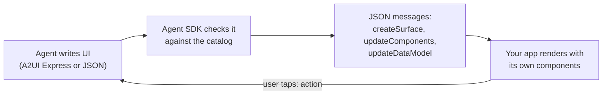

# A2UI 1.0: let your agent answer with UI, not text

You commented UI, so here's the full breakdown.

**The short version.** [A2UI 1.0](https://developers.googleblog.com/a2ui-10-build-delightful-fast-reliable-agentic-experiences/) is Google's open source framework for generative UI, released Nov 11, 2026. Your agent sends JSON that describes the components and data it wants to show. Your app draws them with its own native components. The data can update live, and taps and form inputs flow back to the agent. Everything below was checked against the blog post, [the GitHub repo](https://github.com/a2ui-project/a2ui) and the [a2ui.org docs](https://a2ui.org/quickstart/) on Nov 23, 2026.

## What A2UI is

A2UI stands for Agent-to-User Interface. The repo calls it "an open-source generative UI framework, complete with a protocol optimized for streaming dynamic user interfaces at low latency, native renderers for web and mobile frameworks, and agent SDKs in several popular languages" ([GitHub](https://github.com/a2ui-project/a2ui)). It's Apache 2.0 licensed.

Three things make it different from "let the model write HTML":

- **UI as data, not code.** The agent sends JSON. No HTML, CSS or scripts reach your app ([Catalogs](https://a2ui.org/concepts/catalogs/)).
- **Your components.** Agents "place and configure only the components you register" ([Google](https://developers.googleblog.com/a2ui-10-build-delightful-fast-reliable-agentic-experiences/)). The result looks like your app because it is your app.
- **Native rendering.** No WebView needed. The same agent output renders on web, mobile and desktop ([GitHub](https://github.com/a2ui-project/a2ui)).

## Why it beats a text reply

Google's framing: agents today answer almost everything in text, and "a wall of text" is "a poor way to compare three products or edit and approve a detailed plan" ([Google](https://developers.googleblog.com/a2ui-10-build-delightful-fast-reliable-agentic-experiences/)). With A2UI the agent can answer with a form to confirm, a chart, or a set of cards you tap.

Their example: you wake up sick and need to book a video visit, move meetings, set an out-of-office and more. A text agent gives you a numbered list, then round after round of "which ones?". An A2UI agent can show one view of all of it. Changes are a couple of taps, and nothing is sent until you confirm.

## How it works



1. **Surface.** One area of UI the agent controls, like a card in the chat. Created with `createSurface` ([Messages](https://a2ui.org/concepts/messages/)).
2. **Components.** A flat list where each component points to its children by id, starting from `root`. Flat lists are easy for a model to stream piece by piece ([Catalogs](https://a2ui.org/concepts/catalogs/)).
3. **Data model.** Each surface has its own JSON data. Components bind to paths in it like `/flights/0/price`. When the agent or the user changes a path, only the components bound to it update ([Data binding](https://a2ui.org/concepts/data-binding/)).
4. **Live updates.** `updateDataModel` changes values without resending the components. That's how the UI updates in real time.
5. **Actions back.** When the user taps a button, the renderer sends an `action` message to the agent with the current values filled in.
6. **Renderers.** React, Angular and Lit on the web, Flutter on mobile, web and desktop, SwiftUI on iOS. Jetpack Compose on Android is on v0.9.1, with 1.0 "coming soon" ([Google](https://developers.googleblog.com/a2ui-10-build-delightful-fast-reliable-agentic-experiences/)). Agent SDKs are in Python, TypeScript and Dart.

The server never knows which client it's talking to. Adding a platform means writing a renderer for the same catalog, with no change to the agent ([Step-by-step](https://a2ui.org/quickstart/step-by-step/)).

## A real example

These are from the [Messages docs](https://a2ui.org/concepts/messages/), lightly trimmed.

**1. The agent creates a surface with components and data in one message:**

```json
{
  "version": "1.0",
  "createSurface": {
    "surfaceId": "flight_search",
    "catalogId": "https://a2ui.org/specification/v1_0/catalogs/basic/catalog.json",
    "components": [
      {"id": "root", "component": "Column", "children": ["title", "flight_card"]},
      {"id": "title", "component": "Text", "text": "Available Flights"},
      {"id": "flight_card", "component": "Card", "child": "flight_info"},
      {"id": "flight_info", "component": "Text", "text": {"@path": "/flights/0/summary"}}
    ],
    "dataModel": {
      "flights": [{"summary": "LH458 · BER -> SFO · $680", "price": 680}]
    }
  }
}
```

**2. A button carries an action.** In an `updateComponents` message:

```json
{
  "id": "btn_select_lh458",
  "component": "Button",
  "child": "btn_select_label",
  "action": {
    "event": {
      "name": "select_flight",
      "userMessage": "Selected flight LH458",
      "context": {"flightId": "LH458", "price": {"@path": "/flights/0/price"}}
    }
  }
}
```

**3. The user taps it, and the agent gets this back:**

```json
{
  "version": "1.0",
  "action": {
    "name": "select_flight",
    "surfaceId": "flight_search",
    "sourceComponentId": "btn_select_lh458",
    "timestamp": "2026-11-02T10:15:30.000Z",
    "userMessage": "Selected flight LH458",
    "context": {"flightId": "LH458", "price": 680}
  }
}
```

**4. The agent updates the data live:**

```json
{
  "version": "1.0",
  "updateDataModel": {
    "surfaceId": "flight_search",
    "path": "/selectedFlight",
    "value": {"flightId": "LH458", "status": "confirmed", "passengers": 2}
  }
}
```

In practice the model usually doesn't write this JSON itself. It writes **A2UI Express**, a short notation, and the agent SDK turns it into these messages and checks each one ([Step-by-step](https://a2ui.org/quickstart/step-by-step/)). The docs say raw wire JSON is roughly three times longer than Express, because of repeated keys and ids ([Inference formats](https://a2ui.org/concepts/inference-formats/)).

## Get started

**1. Run the quickstart app.** A trip planner with a Python server, a React web client and a Flutter mobile client. You need Python 3.11+, Node 20+ for web and Flutter 3.38+ for mobile ([Step-by-step](https://a2ui.org/quickstart/step-by-step/)):

```bash
git clone https://github.com/a2ui-project/labs
cd labs/samples/travel-a2ui
./scripts/quickstart.sh both
```

Open http://127.0.0.1:8080 for web and http://127.0.0.1:8080/flutter/ for mobile. Paste a free Gemini key from AI Studio when it asks.

**2. Give your coding agent the A2UI skills.** In your project ([Quickstart](https://a2ui.org/quickstart/)):

```bash
npx skills add a2ui-project/a2ui
```

That gives your coding agent the protocol rules, SDK integration guides and catalog authoring workflows. The docs list Claude Code, Gemini CLI, Cursor, Codex and Windsurf ([llms.txt](https://a2ui.org/llms.txt)).

**3. Try it with no install.** [A2UI Composer](https://a2ui-editor.ag-ui.com) lets you prompt, inspect streamed messages and edit surfaces side by side. The [A2UI Playground](https://go.copilotkit.ai/a2ui-playground) by CopilotKit is a browser sandbox.

## Designing agent behavior around it

This is the interesting part. A2UI doesn't decide when to show UI. Your skills and your catalog do. The docs split the work like this ([Step-by-step](https://a2ui.org/quickstart/step-by-step/)):

| The model decides | You, the builder, decide |
|---|---|
| Whether to show a card | Which components and functions exist (the catalog) |
| Which components, and the layout | The data in them |
| The wording | That every message is checked against the catalog |
| What to ask next | What a press records |

**The catalog is the guardrail.** It lists every component and function the agent may use. The server checks every message the model writes against it before sending, and the client implements everything in it, "so the agent can only ask for what the client knows how to draw" ([Step-by-step](https://a2ui.org/quickstart/step-by-step/)). A catalog can also hold `instructions` that the agent SDK adds to the system prompt ([Catalogs](https://a2ui.org/concepts/catalogs/)).

**Skills teach the model.** A skill is a Markdown file that teaches a model to write A2UI for a catalog. Each component entry says when to use it, for example `FlightOption`: "Use one per option when presenting a choice of flights." The SDK can generate skills from the catalog, so they stay in sync when a component changes.

**UI vs text.** The docs' rule of thumb: if it should look the same on every turn, build it yourself as app code. If it depends on what the user just asked, let the agent compose it. In the sample app, the chat bubbles stay plain text and only the cards and trip panel are A2UI. Keep text and A2UI messages separate at the transport: text goes to the model, A2UI actions go to your renderer message handler ([Agent integration](https://a2ui.org/guides/agent-integration/)).

**Safety.** The agent never sends code. Values can bind on the server, so "sensitive values never reach the model" ([Google](https://developers.googleblog.com/a2ui-10-build-delightful-fast-reliable-agentic-experiences/)). The repo points to this for remote or third-party agents that shouldn't touch card numbers or PII ([GitHub](https://github.com/a2ui-project/a2ui)).

## Who uses it

From [Google's post](https://developers.googleblog.com/a2ui-10-build-delightful-fast-reliable-agentic-experiences/):

- **Atlassian** is bringing it to Jira. When an agent working on a ticket needs a missing detail or a decision, it asks with an interactive card in the work item.
- **Alation** builds its feeds (metric cards, charts) with A2UI. The same feed renders in Claude and in Alation's own app.
- **ByteDance** released an A2UI renderer for Lynx in June 2026. Lynx supports 0.9 today and is moving to 1.0.
- **Bloomberg** is named as building with it.
- **Google**: Gemini Notebook uses option and review cards before it makes a slide deck. Gemini renders A2UI from registered agents (0.9.1 today), and Gemini Enterprise is being upgraded to 1.0.

The web and Flutter renderers also work inside MCP Apps, so A2UI screens can show up in assistants like Claude and Gemini.

## How I'll use it in Cortext

Coming soon. I want Cortext agents to pick a card when you need to compare, choose or approve something, and stay in text when text is enough. I'll share how it goes once it's in.

## Fine print

- A2UI 1.0 is the protocol version. Jetpack Compose and Gemini are still on 0.9.1, and Lynx on 0.9, per Google's post.
- The quickstart app is a learning sample, "not meant for production use" ([Quickstart](https://a2ui.org/quickstart/)).
- The JSON examples above are trimmed from the docs. Check the [v1.0 spec](https://a2ui.org/specification/v1.0-a2ui/) before you build.

## Want more like this?

More agent breakdowns and the full lessons are inside my Skool community, **Agent Architects**: https://www.skool.com/agent-architects
