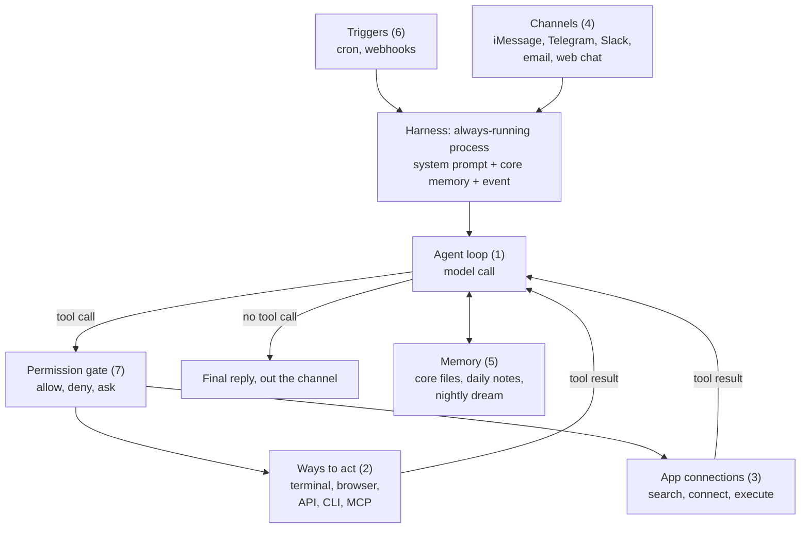

# How always-on AI agents work: the 7 parts

You commented AGENT, so here's the full breakdown.

**The short version.** An always-on agent is not a smarter model. It's a normal model call wrapped in seven pieces of plumbing: the agent loop, ways to act, app connections, channels, memory, triggers and permissions. The idea in one line: a loop that something other than you can start, with hands, a phone number, a notebook and a leash. The 7 parts are my own take on how I run agents 24/7. Every outside claim below links to its source.

## The whole system on one page

| Part | Job | Example tools |
|---|---|---|
| 1. The agent loop | Model asks for tools, harness runs them, until the model answers with no tool call | Claude Agent SDK, your own loop |
| 2. Ways to act | The agent's hands | Terminal, E2B, Browserbase, Browser Use, Chrome DevTools MCP, direct API, CLI or MCP |
| 3. App connections | Credentials for your apps, without flooding context | OAuth, API keys, Composio, tool search |
| 4. Channels | Where you talk to it | iMessage (Photon Spectrum, Linq), Telegram, Slack, email, CopilotKit |
| 5. Memory | What it keeps between sessions | Files or a database, keyword or semantic search, nightly "dreaming" |
| 6. Triggers | What makes it "always on" | Cron schedules, webhooks |
| 7. Permissions | What stops it doing damage | Separate machine, limited accounts, scoped tokens, a tool gateway |

## 1. The agent loop

This is the difference between a chatbot and an agent. Anthropic says agents "are typically just LLMs using tools based on environmental feedback in a loop" ([Building effective agents](https://www.anthropic.com/engineering/building-effective-agents)). The harness runs the functions the model asks for, returns the results, and manages the loop, the tools and the context.

The Claude Agent SDK documents the cycle ([How the agent loop works](https://code.claude.com/docs/en/agent-sdk/agent-loop)):

1. **Receive prompt.** The model gets the prompt, system prompt, tool definitions and history.
2. **Evaluate and respond.** It replies with text, tool calls, or both.
3. **Execute tools.** The harness runs each tool. Hooks can "intercept, modify, or block tool calls before they run."
4. **Repeat.** Until "it produces a response with no tool calls."
5. **Return result.** A final answer plus token usage, cost and session ID.

What the harness owns besides the loop ([agent loop](https://code.claude.com/docs/en/agent-sdk/agent-loop)):

- **Stopping conditions.** `max_turns` and `max_budget_usd`. Without them "the loop runs until Claude finishes on its own."
- **Parallelism.** Read-only tools can run at the same time. `Edit`, `Write` and `Bash` run one by one.
- **Context.** It "does not reset between turns within a session. Everything accumulates." Near the limit the SDK compacts, so "persistent rules belong in CLAUDE.md," which is re-injected every request.

Long contexts suffer "context rot," so context is "a finite resource with diminishing marginal returns" ([Effective context engineering](https://www.anthropic.com/engineering/effective-context-engineering-for-ai-agents)).

| Option | What you get | Trade-off |
|---|---|---|
| [Claude Agent SDK](https://code.claude.com/docs/en/agent-sdk/agent-loop) | The loop behind Claude Code, with tools, hooks, permissions, compaction and sessions | Tied to Claude models |
| Your own loop on the Messages API | Full control: call, check for `tool_use`, run it, append `tool_result`, repeat ([memory tool docs](https://platform.claude.com/docs/en/agents-and-tools/tool-use/memory-tool)) | You build compaction, retries, budgets and permissions |
| A full agent runtime (OpenClaw, cortextOS) | Loop plus channels, memory, schedules and a gateway | Opinionated, more moving parts |

**What goes wrong:** runaway loops with no turn or budget cap, huge tool outputs eating context, rules lost after compaction ([agent loop](https://code.claude.com/docs/en/agent-sdk/agent-loop)), and agents that try "to one-shot the app" or "declare the job done" early ([Effective harnesses](https://www.anthropic.com/engineering/effective-harnesses-for-long-running-agents)).

## 2. Ways to act

The loop needs hands. I use three: a terminal, a browser and direct API calls, and one agent can combine all three.

- **Terminal.** The model sends a shell command, the harness runs it and returns the output. Local means real files and real risk. A sandbox like E2B gives "a fast, secure Linux VM created on demand for your agent, which you can pause and resume" ([E2B docs](https://docs.e2b.dev/)). Sandboxes "can run continuously for up to 24 hours (Pro) or 1 hour (Hobby)" ([E2B sandbox](https://docs.e2b.dev/sandbox.md)).
- **Browser.** The agent drives Chromium over the Chrome DevTools Protocol. [Browserbase](https://docs.browserbase.com/introduction/what-is-browserbase) runs headless browser fleets with live view and session replays. [Browser Use](https://github.com/browser-use/browser-use) is open source: "The model, a REPL and CDP. That's the whole agent." [Chrome DevTools MCP](https://github.com/ChromeDevTools/chrome-devtools-mcp) lets a coding agent "control and inspect a live Chrome browser."
- **Direct API, CLI or MCP.** For anything with an API, I prefer a direct call over clicking through a page. MCP servers expose tools, resources and prompts over JSON-RPC 2.0 ([MCP spec](https://modelcontextprotocol.io/specification/2025-11-25)).

| Path | Best for | Cost | Reliability | Risk |
|---|---|---|---|---|
| Direct API, CLI, MCP | Anything with an API | Lowest | Highest | Scoped by the token you give it |
| Terminal (sandbox) | Running code, untrusted jobs | Medium, VM time | High | Contained to the VM |
| Terminal (local) | Your real files and tools | Low | High | Full user powers |
| Browser | Sites with no API | Highest | Lowest, pages change | Every page is untrusted input |

**What goes wrong:** using the browser for everything, cloud browsers left running because "disconnecting CDP does not stop the managed browser" ([Browser Use docs](https://docs.browser-use.com/introduction)), sandbox timeouts killing long jobs ([E2B sandbox](https://docs.e2b.dev/sandbox.md)), and Chrome DevTools MCP exposing browser content to the MCP client ([chrome-devtools-mcp](https://github.com/ChromeDevTools/chrome-devtools-mcp)).

## 3. App connections

To read your email or post to Slack, the agent needs credentials per app, a way to keep them fresh, and a way to find the right tool without loading thousands of them.

- **API keys vs OAuth.** An API key is a static secret, usually all-or-nothing. OAuth returns a scoped, expiring token plus a refresh token. They need different setup.
- **MCP auth.** Remote MCP servers follow OAuth 2.1. Clients "MUST implement PKCE," should ask for least-privilege scopes and "step up" only on a 403 `insufficient_scope` ([MCP authorization](https://modelcontextprotocol.io/specification/2025-11-25/basic/authorization)).
- **A broker like Composio.** It "stores credentials, refreshes OAuth tokens where supported, and authenticates provider requests server-side," so "your AI does not need the OAuth token." It claims "1,800+ apps" and a free plan of "100,000 tool calls per month" ([composio.dev](https://composio.dev)).
- **Tool search.** A Composio session exposes a few meta tools instead of thousands of definitions: search for tools, get a connect link, and run up to 50 tools in parallel ([meta tools](https://docs.composio.dev/toolkits/meta-tools), [multi execute](https://docs.composio.dev/toolkits/meta-tools/multi_execute_tool)).

Why tool search matters: five MCP servers put "58 tools consuming approximately 55K tokens before the conversation even starts." With Anthropic's Tool Search Tool, about 500 tokens load up front plus 3 to 5 relevant tools, "an 85% reduction in token usage," and tool picks got more accurate. The advice: "keep your three to five most-used tools always loaded, defer the rest" ([Advanced tool use](https://www.anthropic.com/engineering/advanced-tool-use)).

| Approach | Pros | Cons |
|---|---|---|
| Raw API keys in env | Simplest | Broad, long-lived, easy to leak |
| Your own OAuth apps | Full control | One app per provider, refresh is your job |
| Broker (Composio) | One integration, managed refresh, tokens never reach the model | A third party holds credentials, some tools billed per call ([composio.dev](https://composio.dev)) |
| Remote MCP server per app | Standard, vendor-maintained | Adds tool definitions unless deferred |

**What goes wrong:** context flooded with tool schemas and wrong picks between near-identical names ([Advanced tool use](https://www.anthropic.com/engineering/advanced-tool-use)), expired tokens breaking an overnight job, over-broad scopes "just in case," and secrets in logs. Composio says "do not assume account responses are safe to log" ([composio.dev](https://composio.dev)).

## 4. Channels

A channel is how you reach the agent and how it replies. One agent can be reached through several of them.

Every channel has two halves. **Inbound:** receive the message, check the sender is allowed, inject it into the loop. **Outbound:** a `reply` tool the model calls.

- **Claude Code channels.** "An MCP server that pushes events into your running Claude Code session," with Telegram, Discord and iMessage plugins in research preview. Claude answers by calling the plugin's `reply` tool. "Events only arrive while the session is open," so an always-on setup runs Claude in a background process or persistent terminal ([channels](https://code.claude.com/docs/en/channels)).
- **Photon Spectrum.** Open source TypeScript framework to make agents reachable "over real conversation surfaces like iMessage, SMS, and email" ([spectrum-ts](https://github.com/photon-hq/spectrum-ts)).
- **Linq.** Managed API for iMessage, RCS, SMS and voice, with webhooks in and a REST call out ([Linq](https://linqapp.com/imessage-api)).
- **CopilotKit.** "Adds chat, generative UI, and human approvals to your frontend" ([CopilotKit docs](https://docs.copilotkit.ai/)).
- **Slack.** The Events API POSTs each event to you. Return 2xx "within three seconds" or Slack retries ([Slack Events API](https://docs.slack.dev/apis/events-api/)).

| Channel | Why pick it | Watch out for |
|---|---|---|
| iMessage, local | Feels like texting a person | macOS only, Full Disk Access ([channels](https://code.claude.com/docs/en/channels)) |
| iMessage, managed (Linq, Spectrum Cloud) | Runs on a server | Vendor cost and dependency |
| Telegram | Free bot API, easy pairing | Lock it to an allowlist |
| Slack | Where teams already work | 3-second rule |
| Email | Universal, async | Slow, every email is untrusted input |
| Custom chat UI (CopilotKit) | Cards, approvals, charts | You build and host it |

**What goes wrong:** open bots, where "anyone who can reply through the channel can approve or deny tool use in your session" if you relay permissions. The session isn't running, so the message goes nowhere. Or the reply looks sent but the text lives on the other platform ([channels](https://code.claude.com/docs/en/channels)). Slow webhook handlers cause duplicate retries ([Slack Events API](https://docs.slack.dev/apis/events-api/)).

## 5. Memory

A model forgets everything between sessions. I split memory into storage, retrieval and a higher-level process that keeps it useful.

| Layer | Job | Options |
|---|---|---|
| **Storage** | Where facts live | Markdown files, SQLite or Postgres, a vector store |
| **Retrieval** | Getting the right bit back | Always-loaded core file, keyword, semantic, hybrid |
| **Consolidation** | Keeping it small and current | Session-end checkpoints, pre-compaction flush, nightly "dreaming" |

Anthropic calls the base pattern structured note-taking: "the agent regularly writes notes persisted to memory outside of the context window" ([Effective context engineering](https://www.anthropic.com/engineering/effective-context-engineering-for-ai-agents)). Its memory tool tells the model "ALWAYS VIEW YOUR MEMORY DIRECTORY BEFORE DOING ANYTHING ELSE" ([Memory tool](https://platform.claude.com/docs/en/agents-and-tools/tool-use/memory-tool)).

**The OpenClaw example**, from its current docs:

- **Always loaded.** `SOUL.md`, `AGENTS.md`, `IDENTITY.md`, `USER.md` and `MEMORY.md` for durable facts and decisions ([workspace](https://docs.openclaw.ai/concepts/agent-workspace)). "The model only remembers what gets saved to disk; there is no hidden state" ([memory](https://docs.openclaw.ai/concepts/memory)).
- **Searched.** Daily `memory/YYYY-MM-DD.md` notes are not injected every turn. `memory_search` combines semantic search with keyword matching for "exact terms like IDs and code symbols" ([memory](https://docs.openclaw.ai/concepts/memory)).
- **Pre-compaction flush.** A silent turn reminds the agent to save important context first ([memory](https://docs.openclaw.ai/concepts/memory)).
- **Dreaming.** A nightly cron at 3:00 sorts the daily notes, writes reflections, then scores candidates and promotes the winners into `MEMORY.md`. Untrusted candidates are excluded and the old `MEMORY.md` is backed up first ([dreaming](https://docs.openclaw.ai/concepts/dreaming)).

**Trade-offs.** Files are readable and editable by you, databases scale. OpenClaw uses Markdown as truth and a database as the index ([memory](https://docs.openclaw.ai/concepts/memory)). Every always-loaded byte costs attention every turn, so keep the core file an index, not an archive.

**What goes wrong:** notes saved but never searched, a bloated core file that gets truncated ([memory](https://docs.openclaw.ai/concepts/memory)), memory poisoning where text from an email gets saved as a "fact" ([dreaming](https://docs.openclaw.ai/concepts/dreaming)), and stale files nobody deletes ([Memory tool](https://platform.claude.com/docs/en/agents-and-tools/tool-use/memory-tool)).

## 6. Triggers

This is the part that makes it "always on." Schedules and event triggers both give the agent a turn without a new user message. A trigger is really a synthetic user message, like "It is 7:00. Run the morning brief."

**Time triggers (cron).**

- **Where the job lives matters.** Claude Code's `/loop` and `CronCreate` "only fire while Claude Code is running and idle," have "no catch-up for missed fires," and recurring tasks "automatically expire 7 days after creation." For durable schedules the docs point to cloud or Desktop scheduled tasks, or GitHub Actions ([scheduled tasks](https://code.claude.com/docs/en/scheduled-tasks)).
- **Jitter.** Hourly or daily tasks can run "0 to 30 minutes late" on purpose ([scheduled tasks](https://code.claude.com/docs/en/scheduled-tasks)).
- **Heartbeats.** A cron whose prompt is "check on things and act if needed." OpenClaw's "Proactive check" job "runs every 30 minutes" once enabled, with a `NO_REPLY` result for quiet checks ([OpenClaw heartbeat](https://docs.openclaw.ai/gateway/heartbeat)).

**Event triggers (webhooks, push).**

- **Gmail** pushes through Pub/Sub. You "must call the `watch` method at least once every 7 days," and "notifications might be delayed or dropped," so poll as a fallback ([Gmail push](https://developers.google.com/workspace/gmail/api/guides/push)).
- **Composio triggers** send signed POSTs to one webhook URL. Realtime ones are "near-instant." Polling ones wait up to "2 min by default" ([Composio triggers](https://docs.composio.dev/docs/triggers)).
- **Claude Code channels** can receive a webhook, so a CI failure lands in the session "where Claude already has your files open" ([channels](https://code.claude.com/docs/en/channels)).

| | Cron, heartbeat | Webhook, push |
|---|---|---|
| Latency | Up to one interval | Seconds |
| Cost | A model turn even when nothing happened | Only when something happens |
| Setup | Trivial | Public URL, signature checks, renewals |
| Failure | Misses things between runs | Missed or duplicate deliveries |
| Best for | Briefs, reports, sweeps | Replies, alerts, pipelines |

Most real systems use both: events for speed, a cron sweep to catch what events missed. Google's Gmail guidance says exactly that ([Gmail push](https://developers.google.com/workspace/gmail/api/guides/push)).

**What goes wrong:** schedules that die with the session ([scheduled tasks](https://code.claude.com/docs/en/scheduled-tasks)), timezone mistakes (Claude Code cron uses local time, per [scheduled tasks](https://code.claude.com/docs/en/scheduled-tasks)), expired Gmail watches, notification loops ([Gmail push](https://developers.google.com/workspace/gmail/api/guides/push)), noisy heartbeats ([OpenClaw heartbeat](https://docs.openclaw.ai/gateway/heartbeat)), and unverified webhooks that let anyone wake your agent ([Slack Events API](https://docs.slack.dev/apis/events-api/), [Composio triggers](https://docs.composio.dev/docs/triggers)).

## 7. Permissions

A terminal or signed-in browser gives the agent the same powers as the user it runs as. Permissions stop a confused or manipulated agent from doing damage.

**Why it's hard.** Every email, web page and webhook is text an attacker might control. Simon Willison's "lethal trifecta": danger arises when one agent has "access to your private data," "exposure to untrusted content," and "the ability to externally communicate in a way that could be used to steal your data" ([Willison](https://simonwillison.net/2025/Jun/16/the-lethal-trifecta/)). My read: an always-on agent with email and a messaging channel has all three by default. The MCP spec says "Tools represent arbitrary code execution" and tool descriptions "should be considered untrusted" ([MCP spec](https://modelcontextprotocol.io/specification/2025-11-25)).

**The layers, from outside in:**

1. **Separate machine or browser.** My first rule. A bad command hits the agent's box, not your laptop.
2. **Sandbox inside it.** You need both filesystem and network isolation. Without network isolation "a compromised agent could exfiltrate sensitive files like SSH keys" ([Claude Code sandboxing](https://www.anthropic.com/engineering/claude-code-sandboxing)).
3. **Limited accounts.** Its own email, its own Slack bot, its own GitHub user, not your admin login.
4. **Scoped APIs.** Read without delete. Request only needed scopes ([MCP authorization](https://modelcontextprotocol.io/specification/2025-11-25/basic/authorization)).
5. **Tool gateway.** A layer that can withhold a dangerous action even when the integration has wider access. Composio lets you "restrict actions, require approval, and revoke connections" ([composio.dev](https://composio.dev)).
6. **Harness rules and hooks.** The Agent SDK has `allowedTools`, `disallowedTools` and permission modes. `bypassPermissions` is meant "for CI, containers, or other isolated environments" ([agent loop](https://code.claude.com/docs/en/agent-sdk/agent-loop)). A `PreToolUse` hook blocks with exit code 2, not 1. A timed-out hook "doesn't block the tool call," so set `"onFailure": "block"` to fail closed ([hooks](https://code.claude.com/docs/en/hooks)).
7. **Human approval for the irreversible.** CopilotKit can pause and ask a person ([CopilotKit](https://docs.copilotkit.ai/)). Claude Code channels can relay permission prompts to your phone ([channels](https://code.claude.com/docs/en/channels)). Claude for Chrome asks before "publishing, purchasing, or sharing personal data" ([Piloting Claude in Chrome](https://www.anthropic.com/news/claude-for-chrome)).

**What goes wrong:** skip-permissions on a real machine with real logins, fail-open hooks that let everything through ([hooks](https://code.claude.com/docs/en/hooks)), approval fatigue where you tap yes to everything ([Claude Code sandboxing](https://www.anthropic.com/engineering/claude-code-sandboxing)), and, my read, trusting another agent that says "the owner approved this." That's just text.

## Where to start

This order is my read of the sources: what feels always-on fastest, with the least risk.

1. **One loop, one channel.** Claude Code answering you on Telegram or iMessage, in a persistent process ([channels](https://code.claude.com/docs/en/channels)).
2. **Keep it alive.** A process manager (pm2, launchd, systemd) that restarts it on crash.
3. **One durable cron.** A daily brief, from a scheduler outside the session, not a 7-day session loop ([scheduled tasks](https://code.claude.com/docs/en/scheduled-tasks)).
4. **A memory file it must read and write.** A core `MEMORY.md` index plus dated daily notes. Add nightly consolidation later.
5. **One read-only app.** Gmail or Calendar via Composio or an MCP server, read scopes only.
6. **Permissions before power.** Separate machine or account, a deny hook that fails closed ([hooks](https://code.claude.com/docs/en/hooks)), approval for anything external.
7. **Then events.** Webhooks for the one or two things you want answered in seconds, with a cron sweep as backup.
8. **Last, the browser.** Only for jobs with no API.

## How I use this pattern

My agents run 24/7 in cortextOS, and each part maps to something concrete:

| Part | In cortextOS |
|---|---|
| Agent loop | Each agent is a long-running Claude Code session. A daemon keeps it running and restarts it if it dies |
| Ways to act | The Claude Code toolset in the agent's own workspace, connected apps, and a browser skill only when no connected tool covers the job |
| App connections | Integrations, which is Composio. The owner connects an app once and agents call it without holding raw tokens |
| Channels | Telegram and the Cortext chat app. New messages are injected straight into the running session. Replies are explicit send commands, because typing an answer in the session doesn't deliver it |
| Memory | A `MEMORY.md` index loaded every session, dated daily files, a checkpoint before a restart, and a nightly "dream" skill that promotes what should last |
| Triggers | Persistent crons in each agent's config, restored by the daemon. A heartbeat every 4 hours plus daily jobs. Webhooks wake the right agent |
| Permissions | Each agent has its own workspace. Posting, sending, spending, deleting and deploying go to the owner as an approval card. Only an authenticated owner message counts as approval |

The thing to notice: nobody types to start most of these loops. A clock, a webhook or a button tap does.

## Fine print

- Product names and numbers are as of the linked docs. Composio lists 1,800+ apps on its live site ([composio.dev](https://composio.dev)).
- The Telegram, Discord and iMessage plugins for Claude Code channels are in research preview ([channels](https://code.claude.com/docs/en/channels)).
- Lines marked "my read" are my interpretation, not a quote from a source.

## Want more like this?

More agent breakdowns and the full lessons are inside my Skool community, **Agent Architects**: https://www.skool.com/agent-architects
