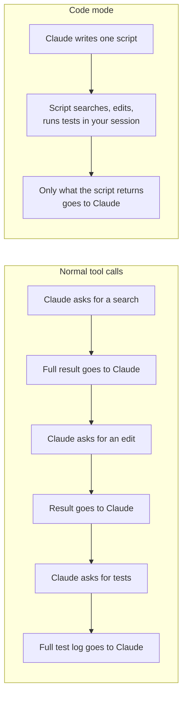

# Claude Code code mode: the full guide

You commented "code mode", so here's the full breakdown.

Normally Claude Code calls one tool at a time. It asks for a Bash command or a file read, waits for the result, reads it, then decides the next step. Code mode changes that. Claude writes a short piece of JavaScript that makes the tool calls, and Claude Code runs that code in your session. One script can run commands in parallel, feed one result into the next call, and hand back only the part of the output Claude needs to read.

It is experimental, off by default, and Anthropic says it may change or be removed in any release. Everything on this page was checked against Claude Code 2.1.327 and the official docs on 2026-11-18.

**The short version:**

- **Turn it on:** `CLAUDE_CODE_EXPERIMENTAL_CODE_MODE=1 claude`, then confirm the prompt.
- **Use it for:** jobs that take many related tool calls. The same edit in many files, a search you want filtered before Claude reads it, several independent commands at once.
- **Your guardrails still hold:** `deny` and `ask` rules and `PreToolUse` hooks still see every tool call inside the code.
- **The catch:** in auto mode, the safety classifier reviews the script once, before it runs, not each call inside it.
- **Where it runs:** only in an interactive `claude` session in a terminal, on a Claude subscription or Console account, on Opus 5.5, Sonnet 5.5, Haiku 5.5 or Fable 5.2.

---

## The mental model

Think of the normal loop as a phone call where Claude has to hang up and call back after every question. "What files mention retryPolicy?" Hang up. Read the answer. Call back. "Open this one." Hang up. Every step is a round trip through the model, and every result lands in Claude's context in full, whether it needed all of it or not.

Code mode lets Claude write the whole errand down as a short script and hand it over. The script does the looking, the looping and the filtering on your machine, and only the final answer comes back.



Here is the example from Anthropic's docs. You ask Claude to raise a retry limit, and it writes this:

```javascript
const files = await $`rg -l "function retryPolicy" src`.text();
const target = files.trim().split("\n")[0];
await edit(target, "maxAttempts: 3", "maxAttempts: 5");
({ edited: target, tests: $`npm test -- retryPolicy`.nothrow() });
```

Reading it line by line:

1. Run a search and keep its text.
2. Take the first file it found.
3. Edit that file.
4. Run the tests. `.nothrow()` means a failing test run comes back as output instead of stopping the script. The last line is what Claude gets back: the file it edited and the test output.

Three things to hold in your head:

- **It is still your tools.** The script calls Bash, Read, Edit and the rest. Each call keeps its usual name, so your rules and hooks still match it.
- **It runs in your session.** Anthropic's docs say Claude Code runs the code in your session, so it acts on your machine and your project, with your tools.
- **You see the calls, not the code.** The conversation shows the tool calls, like an edit's diff. To read the JavaScript, press `Ctrl+O` to open the transcript viewer and expand a **Code** row. Press `Ctrl+O` again to go back.

The payoff is fewer round trips and less noise in Claude's context: a long search result or test log can be cut down to the part that matters before Claude ever reads it. Anthropic has not published speed or token numbers for code mode, so treat any number you see online as one person's run, not a benchmark.

Code mode in Claude Code is not the same thing as Programmatic Tool Calling on the Claude API. Code mode is a Claude Code feature that runs in your Claude Code session.

---

## Setup

### 1. Check your version

```bash
claude --version
```

You need v2.1.323 or later. If you are older, run `claude update`. If you are on the `stable` release channel and the update doesn't reach 2.1.323, wait for `stable` to catch up or switch to the `latest` channel.

### 2. Turn it on

For one session, set the variable in your shell:

```bash
CLAUDE_CODE_EXPERIMENTAL_CODE_MODE=1 claude
```

On Windows PowerShell:

```powershell
$env:CLAUDE_CODE_EXPERIMENTAL_CODE_MODE = "1"
claude
```

For every new session, add it to the `env` block of your user settings, `~/.claude/settings.json`:

```json
{
  "env": {
    "CLAUDE_CODE_EXPERIMENTAL_CODE_MODE": "1"
  }
}
```

Where the variable counts:

| Where you set it | Turns code mode on? |
|---|---|
| Your shell | Yes |
| User settings (`~/.claude/settings.json`) | Yes |
| A `--settings` file | Yes |
| Project or local settings (`.claude/settings.json` in a repo) | No. A repo you clone can't turn it on for you |
| Managed settings | Can't turn it on for you. A `0` blocks it. If managed settings contain a `1`, set your own `1` in user settings, because a `1` in your shell is then ignored |

A `0` in your shell, user settings, a `--settings` file or managed settings keeps it off, whatever you set elsewhere.

### 3. Confirm

The first time, Claude Code asks you to confirm. Pick **Yes, turn on Code Mode**. Claude Code restarts and shows this near the top of the session:

```text
Code Mode (experimental) is on · this session can be resumed only with Code Mode on
```

If you see `Code Mode (experimental) isn't available` instead, the reason is on the same line and in `/status`. Jump to [Troubleshooting](#troubleshooting).

### 4. Give it a first task

Anthropic suggests this one. Run it in a project you know:

```text
Read every Markdown file in this project and list the links that point to local files that don't exist.
```

Then press `Ctrl+O`, expand a **Code** row, and read what Claude wrote. Do this for your first few sessions. It is the fastest way to learn what code mode is actually doing for you.

### 5. Resuming and turning it off

- **Resuming:** keep the variable set to `1` when you run `claude --continue` or `claude --resume`. With code mode off, Claude Code refuses to resume a code mode session. A session you started without code mode resumes without it, even with the variable set. You can resume a code mode session only in the terminal.
- **Off:** remove the variable from your shell and `~/.claude/settings.json` and start a new session, or set it to `0`.
- **Block it for an organization:** put `"CLAUDE_CODE_EXPERIMENTAL_CODE_MODE": "0"` in the `env` block of your managed settings. People already in a code mode session stay in it until they exit or restart. After that they start without it and can't resume their code mode sessions while the `0` is in place. You can't turn it on for users from managed settings.

---

## Requirements

| | Needed |
|---|---|
| Version | Claude Code v2.1.323 or later. v2.1.326 or later if agent teams are on |
| Install | The native build of Claude Code |
| Account | A Claude subscription or Console account |
| Model | Claude Opus 5.5, Sonnet 5.5, Haiku 5.5 or Fable 5.2 |
| Surface | An interactive `claude` session in a terminal |
| Windows | Git for Windows installed |

It does **not** work:

- With `claude -p`, the Agent SDK, the VS Code panel, the Desktop app or cloud sessions.
- Through a gateway, a custom `ANTHROPIC_BASE_URL`, Amazon Bedrock, Claude Platform on AWS, Google Cloud's Agent Platform, Microsoft Foundry, or Claude Models on Google Cloud (Anthropic managed).
- In organizations on the HIPAA configuration or zero data retention.
- With an API key helper (`apiKeyHelper`, `ANTHROPIC_AUTH_TOKEN`, or an auth header in `ANTHROPIC_CUSTOM_HEADERS`), with OpenTelemetry export on, or with `DISABLE_TELEMETRY` or another variable that turns off feature-flag fetching.

While it is on, you can't use Remote Control, Claude in Chrome or computer use. You can't move the session to the Desktop app or turn it into a background session, and `/fork` can't start a background copy.

---

## 12 workflows, with prompts

You don't write the JavaScript. You describe the job and Claude writes the code to carry it out. What changes is how you phrase the job: tell Claude what to do across the whole set and what you want back, and code mode has room to work.

A pattern that runs through all of these: **say what you want returned.** "Give me only the failures," "just the file and line," "a table of what changed." That is the line that keeps noise out of Claude's context.

The flip side: **don't let the filter hide a failure.** If a script trims a build log down to "the errors" and the build died before it printed any, Claude sees nothing and may report success. For anything that runs commands, add "always include each command's exit code and the last 20 lines of output when it fails" to your prompt.

Two habits that make every workflow below safer:

- **Start from a clean git state.** A script can make many edits in one step. If it throws halfway, some edits may already be on disk. With a clean tree, `git diff` shows you exactly what happened and `git restore` undoes it.
- **Ask for a dry run first on bulk changes.** "List what you would change, don't change it yet" costs one extra prompt and turns a bulk edit into something you can review.

### 1. The same change across many files

The textbook case from the docs: a change that repeats across many files.

```text
Rename the config key `retryCount` to `maxRetries` in every file under src/ and config/.
Skip anything in node_modules or dist. When you're done, give me a list of the files
you changed and a count of replacements per file.
```

Tip: ask for the list first, check it, then say "go." The first run becomes a dry run you can read.

### 2. Search, filter, then read

Also straight from the docs: a search whose results need filtering before Claude reads them.

```text
Find every TODO and FIXME in src/. Ignore the ones in test files and generated code.
Give me back only file:line and the comment text, grouped by folder.
```

The raw search might be thousands of lines. Claude only reads the filtered list.

### 3. Run independent checks at the same time

```text
Run the linter, the type checker and the unit tests in parallel.
Only show me what failed, with the file and the first error line for each failure.
If everything passes, just say so.
```

These three don't depend on each other, so there is no reason to wait for one before starting the next.

### 4. Run the tests and open only what broke

```text
Run the full test suite. For each failing test, open the test file and the source file
it covers, and tell me the most likely cause. Don't fix anything yet.
```

A failing command comes back as data the script can act on, so "run, then look at the failures" happens in one step instead of a long back-and-forth.

### 5. Find, then fix, in one move

```text
Find the function that builds the S3 upload URL, change its expiry from 15 minutes to 60,
then run the tests for that module.
```

This is the docs example in different clothes: one result (the file path) feeds the next call (the edit), and the tests run right after.

### 6. Broken links and missing files

Anthropic's own first-task suggestion, and a good audit for any docs folder:

```text
Read every Markdown file in this project and list the links that point to local files
that don't exist. Group them by the file they're in.
```

### 7. Project-wide inventory

```text
List every environment variable this project reads, where it's read, and whether it's
documented in README.md or .env.example. Return a table.
```

Lots of reads, one small answer. That's the shape code mode is good at.

### 8. Dependency and import sweeps

```text
Find every file that imports from `lib/legacy-auth`. For each one, tell me which
functions it uses. Don't change anything.
```

Run this before a refactor so you know the blast radius.

### 9. Log and output triage

```text
Read the last 2,000 lines of logs/server.log. Group errors by message, count each group,
and show me the top five with one example line each.
```

You get the summary, not 2,000 lines in context.

### 10. A long build or test run in the background

```text
Run the full end-to-end suite in the background. While it runs, let's go through
the open review comments on this branch.
```

This needs the session to start in auto or `bypassPermissions` mode. See [Long-running code](#long-running-code).

### 11. Repeated checks across many folders

```text
For every package in packages/, run its build and tell me which ones fail.
Show the first error for each failing package.
```

A loop over folders is one script, not one tool call per package.

### 12. Agent team teammates

If you use agent teams (v2.1.326 or later), teammates run in code mode too, in the default in-process display mode. In split panes they start without it. Give teammates the same kind of brief: the whole job, and exactly what to report back.

---

## When not to use it

Code mode is a tool for jobs with many related calls. It doesn't make every task better.

- **One-step jobs.** "Read this file" or "run this command" gains nothing. There is no chain to collapse.
- **Exploratory work where each step depends on judgment.** If what Claude should do next depends on actually understanding the last result, not filtering it, normal one-at-a-time calls fit better.
- **Anything destructive in auto mode** where the target is decided at run time (for example "delete every file the search finds"). The classifier reviews the script before it runs and can't see the paths the search returns. Keep deletes, pushes, deploys and migrations as separate, approved steps.
- **Headless or scripted runs.** It doesn't work with `-p` or the Agent SDK, so it's not for CI.
- **Sessions you need to hand off.** You can't move a code mode session to the Desktop app, use Remote Control, or turn it into a background session.
- **When you need to see every step as it happens.** You see the tool calls, but the logic that chose them lives in the code. If you need to follow along closely, keep `Ctrl+O` open or turn code mode off for that session.
- **Setups it doesn't support.** Gateways, Bedrock, Google Cloud, Foundry, API key helpers, OpenTelemetry export, HIPAA and zero-data-retention orgs.
- **When the scripts keep breaking.** A script that fails (bad syntax, a quoting mistake in a shell command) means another round trip to fix it, and a few of those cost more than the plain calls would have. If you see Claude rewriting the same script over and over, tell it to do the job step by step, or turn code mode off for that task.
- **When you're relying on MCP tools.** Anthropic's code mode page describes built-in tools like Bash, Read and Edit. It doesn't say whether MCP tools can be called from a script, and we haven't tested it, so don't build a workflow that assumes they can.

### Is it actually helping you?

There are no official numbers, so measure on your own work. Pick a real task that takes many tool calls, run the same prompt on the same model once with code mode off and once on, and compare `/cost` and how long each took. Do it on two or three task types. Bulk edits and filtered searches are where you'd expect a difference. Small, judgment-heavy tasks are where you'd expect none.

---

## Permissions and safety

### What still checks every call

Every tool call inside the code goes through your `deny` and `ask` permission rules and your `PreToolUse` hooks, under the tool's usual name (for example `Bash`). If you have `Bash(git push *)` in `deny`, a script can't push with that command any more than Claude could without code mode.

### What changes, by permission mode

| Mode | What happens |
|---|---|
| Auto mode | The classifier reviews each piece of code once, before it runs, not each tool call inside it. It can't see values computed at run time, like a path taken from search output. Your `hard_deny` and `soft_deny` classifier rules apply to the code as a whole |
| Other modes | The code starts without a review, and you are prompted for each tool call that would normally prompt you in that mode |

So in auto mode, if a call must never happen, don't rely on the classifier. Use a `permissions.deny` rule or a hook.

Two more auto mode details:

- `autoMode.classifyAllShell` (which suspends your shell allow rules in auto mode) still works, but in a code mode session the classifier reviews the code that runs the commands.
- If Claude starts new code while earlier code is still running, the earlier code loses its classifier review, and Claude Code asks you about its remaining calls that would need one. With no IDE connected, the prompt shows a countdown. If you don't answer in time, that call is refused, and later calls that would show a countdown are refused without a prompt. Send Claude a message to see the prompts again.

### The compound command trap

In code mode, a command can reach your hook in a form you didn't expect. Anthropic's example: a `git push` in a folder named `app` can arrive as `cd 'app' && git push`. A hook that only checks whether the command *starts* with `git push` misses it.

Make your hooks check each part of a command the way Bash rules do: split on `&&`, `||`, `;`, `|`, `|&`, `&` and newlines, and check every part.

### Rules match text, not intent

Bash rules match command text, so a denied command can still run in a form the rule doesn't match, for example `git -C . push` instead of `git push`. This is true with or without code mode. If a limit has to hold no matter how the command is written, use sandboxing, which doesn't depend on command text.

---

## Hook recipes

All of these go in the `hooks` block of a settings file. The scripts use `jq`, so install it first. We tested each script below against sample hook input before publishing it. We did not run them inside a live code mode session.

### Recipe 1: read the whole script before it runs

The tool that runs code mode scripts is called `REPL`. A `PreToolUse` hook that matches `REPL` gets the JavaScript in `tool_input.code`, so you can refuse a script before any of it runs.

`.claude/settings.json`:

```json
{
  "hooks": {
    "PreToolUse": [
      {
        "matcher": "REPL",
        "hooks": [
          {
            "type": "command",
            "command": "${CLAUDE_PROJECT_DIR}/.claude/hooks/check-repl.sh",
            "onFailure": "block"
          }
        ]
      }
    ]
  }
}
```

`.claude/hooks/check-repl.sh`:

```bash
#!/bin/bash
# PreToolUse hook for the REPL tool: reads the JavaScript before it runs.
CODE=$(jq -r '.tool_input.code // ""')

if printf '%s' "$CODE" | grep -Eq 'git .*push|rm -rf|--force'; then
  jq -n '{
    hookSpecificOutput: {
      hookEventName: "PreToolUse",
      permissionDecision: "deny",
      permissionDecisionReason: "This script pushes, force-pushes or deletes recursively. Run that step on its own so I can approve it."
    }
  }'
else
  exit 0  # no decision; the normal permission flow applies
fi
```

Make it executable with `chmod +x .claude/hooks/check-repl.sh`.

This is a tripwire, not a wall. It reads text, so it's coarse (it will also catch a commit message that says "push"), and a script can build a command string at run time that the text check can't see. That's why recipe 2 exists.

### Recipe 2: check every part of every Bash call

This one runs on each Bash call, including the ones a script makes, and checks each part of a compound command.

```json
{
  "hooks": {
    "PreToolUse": [
      {
        "matcher": "Bash",
        "hooks": [
          {
            "type": "command",
            "command": "${CLAUDE_PROJECT_DIR}/.claude/hooks/guard-bash.sh",
            "onFailure": "block"
          }
        ]
      }
    ]
  }
}
```

`.claude/hooks/guard-bash.sh`:

```bash
#!/bin/bash
# PreToolUse hook for Bash: catches git push in any part of a compound command.
CMD=$(jq -r '.tool_input.command // ""')

# Split on && || ; | & and newlines, then check each part on its own.
if printf '%s\n' "$CMD" \
  | sed -E 's/(&&|\|\||;|\||&)/\n/g' \
  | grep -Eq '^[[:space:]]*git([[:space:]]+-C[[:space:]]+[^[:space:]]+)?[[:space:]]+push'; then
  jq -n '{
    hookSpecificOutput: {
      hookEventName: "PreToolUse",
      permissionDecision: "deny",
      permissionDecisionReason: "git push is blocked in this project. Ask me to push."
    }
  }'
else
  exit 0
fi
```

It blocks `git push`, `cd 'app' && git push`, `git -C . push origin` and `ls | git push`. It lets `npm test; git status` and `git commit -m "push docs"` through. The `sed` line splits on the separators (tested with the `sed` that ships with macOS).

Pair it with a plain deny rule. Rules are simpler and also apply to every call inside the code:

```json
{
  "permissions": {
    "deny": ["Bash(git push *)"]
  }
}
```

### Recipe 3: keep a log of every script

When you're new to code mode, it helps to keep a record of what Claude actually ran. This hook never blocks anything. It appends each script to a log file with a timestamp.

```json
{
  "hooks": {
    "PreToolUse": [
      {
        "matcher": "REPL",
        "hooks": [
          {
            "type": "command",
            "command": "${CLAUDE_PROJECT_DIR}/.claude/hooks/log-repl.sh",
            "onFailure": "continue"
          }
        ]
      }
    ]
  }
}
```

`.claude/hooks/log-repl.sh`:

```bash
#!/bin/bash
# Appends every code mode script to .claude/code-mode.log. Never blocks.
LOG="${CLAUDE_PROJECT_DIR:-.}/.claude/code-mode.log"
{
  printf '\n--- %s ---\n' "$(date '+%Y-%m-%d %H:%M:%S')"
  jq -r '.tool_input.code // ""'
} >> "$LOG"
exit 0
```

Add `.claude/code-mode.log` to `.gitignore`. Read the log after a session and you'll quickly see what Claude actually ran for each kind of job. Recipes 1 and 3 can share one `REPL` matcher entry with two hooks in its list.

### Recipe 4: decide what happens when a hook fails

In code mode, a `PreToolUse` hook that fails or times out refuses the call, even when `onFailure` is unset:

- **`the hook failed`**: on a call from code, the hook couldn't start, was killed, exited with 126, 127 or a code above 128, or returned an HTTP error or invalid output.
- **`the hook did not finish`**: the hook timed out on a call from code, or on any other tool call once Claude has run code in the session.

That's a stricter default than normal mode, where most failed hooks let the call go ahead. Pick deliberately:

- **Safety hook:** set `"onFailure": "block"` so it fails closed in every mode, not only in code mode.
- **Convenience hook (formatting, logging):** set `"onFailure": "continue"` so a crash doesn't stop your work.

`onFailure` works on `command` and `http` hooks.
- **Slow hook:** raise its `timeout`.

One more detail: a `command` hook that exits with an ordinary code such as 1 lets the call go ahead unless you set `"onFailure": "block"`.

### Recipe 5: don't let a prompt hook swallow background output

When code can run in the background, your `command`, `http` and `mcp_tool` hooks on `UserPromptSubmit` also run on the code's output. If one of them blocks, Claude reports your hook's block reason where you expected results. Fix it by having the hook skip its block when the `source` field in its input is `poll_event`:

```bash
#!/bin/bash
INPUT=$(cat)
if [ "$(printf '%s' "$INPUT" | jq -r '.source // ""')" = "poll_event" ]; then
  exit 0  # code output, not something you typed; let it through
fi
# ...your normal prompt checks on $INPUT go here...
```

---

## Long-running code

While code runs a long build or test, Claude either waits for it or lets it keep going in the background:

| | Waiting | Background |
|---|---|---|
| Can you keep talking to Claude? | No, Claude answers when the code finishes | Yes |
| How long can it run? | Ten minutes, including time you spend at permission prompts | Up to two hours |
| What you need | Nothing | Start the session in auto or `bypassPermissions` mode |

The ten minutes counts time at permission prompts. In a mode that prompts, a slow answer from you eats into the script's time.

If Claude still waits when you wanted background:

- **You switched modes mid-session:** press `Shift+Tab` until you're back in the mode you started in.
- **You started in another mode, or picked the session from the `claude --resume` list:** if auto mode is available to you, exit and run `claude --continue --permission-mode auto` with code mode on.
- **You passed tool names to `--tools`:** start again in auto mode without that flag.

---

## Troubleshooting

### Code mode doesn't start

The top of the session says `Code Mode (experimental) isn't available`, followed by a reason. `/status` shows it too.

| The reason says | What to do |
|---|---|
| it isn't open to your account (yet / in this version) | Update to v2.1.323 or later. If you're already there, check your network and try again. If it stays, try again another day |
| it only works (directly) with the Anthropic API | Remove settings that route through a cloud provider, a gateway, or a custom `ANTHROPIC_BASE_URL` |
| it doesn't work with an API key helper | Remove `apiKeyHelper`, `ANTHROPIC_AUTH_TOKEN`, and any `Authorization` or `X-Api-Key` header in `ANTHROPIC_CUSTOM_HEADERS`. Sign in or set `ANTHROPIC_API_KEY` |
| it only works with Opus 5.5, Sonnet 5.5 and later models | Start with a supported model, for example `--model opus`. Haiku 5.5 and Fable 5.2 also work |
| it doesn't work in background jobs | Start in the foreground, without `--remote-control`. In a teammate's split pane, use the in-process display mode |
| it needs settings that Claude Code downloads from Anthropic | Unset `DISABLE_TELEMETRY` or whatever variable turns off feature-flag fetching |
| OpenTelemetry is on | Unset `CLAUDE_CODE_ENABLE_TELEMETRY` and `ENABLE_BETA_TRACING_DETAILED` if you can work without OpenTelemetry export |
| it doesn't yet work with the plugin | Run `/plugin` and disable each plugin it names. If your organization turned one on, ask your admin |
| it doesn't yet work with an installed mod | Turn off the mod that checks tool calls. Claude Code 2.1.327 stopped refusing to start for this, so update first |
| it can't be used together with agent teams yet | Update to v2.1.326 or later, or unset `CLAUDE_CODE_EXPERIMENTAL_AGENT_TEAMS` |
| this launch's tool options | Start without `--restricted`, add `REPL` to `--tools`, and remove `REPL` from `--disallowedTools` and your `deny` rules |
| couldn't save your answer | Make `~/.claude.json` writable |
| your organization's settings don't allow it | Ask your admin about the managed setting |

If there's no line about code mode at all: check `claude --version`, then check that the variable is `1` in your shell or user settings, and remove any `0` from those and from any `--settings` file.

### Other problems

| Symptom | Cause and fix |
|---|---|
| Claude says a tool call was refused | Ask Claude for the error text. `the hook failed` or `the hook did not finish` means a `PreToolUse` hook failed or timed out. See [recipe 4](#recipe-4-decide-what-happens-when-a-hook-fails) |
| A hook's block reason shows up where you expected code output | A `UserPromptSubmit` hook is blocking code output. See [recipe 5](#recipe-5-dont-let-a-prompt-hook-swallow-background-output) |
| Claude says the build passed, but it didn't | The script's filter dropped the error. Ask for exit codes and the end of the output on failure (see the note at the top of [the workflows](#12-workflows-with-prompts)) |
| A script failed partway and files look half-changed | Some edits may have run before the error. Check `git diff`, then ask Claude to finish or undo |
| A permission prompt with a countdown | Earlier code lost its auto mode review because new code started. Answer before the countdown ends |
| A script stopped partway | Code you wait on stops after ten minutes. Use background mode or split the job |
| Claude waits on a long run instead of going to the background | Check how the session started. See [Long-running code](#long-running-code) |
| `claude --resume` refuses the session | Set the variable to `1` and resume from the terminal |
| Your hook let a push through | It probably checked the start of the command only. Use [recipe 2](#recipe-2-check-every-part-of-every-bash-call) |

Recent fixes worth knowing about if you're on an older build: 2.1.325 fixed scripts ignoring a worktree entered with `EnterWorktree`, and Claude starting work by itself after you resumed a session that ended mid-script. 2.1.326 fixed mods being unable to use Bash, Read and other tools through `$.tool.call` and `$.tool.check`. 2.1.327 stopped code mode refusing to start when an installed mod hooks tool calls, and fixed a running script in auto mode getting prompts and denials once Claude started a second script that auto mode also allowed. Keep Claude Code updated while you use an experimental feature.

---

## Limits, all in one place

- Experimental. It may change or be removed in any release. Share feedback with `/feedback`.
- Interactive terminal sessions only. No `-p`, Agent SDK, VS Code panel, Desktop app or cloud sessions.
- Direct Anthropic API only, with a Claude subscription or Console account.
- Four models: Opus 5.5, Sonnet 5.5, Haiku 5.5, Fable 5.2.
- No Remote Control, Claude in Chrome or computer use while it's on.
- Resume only in the terminal, with code mode on.
- Code you wait on stops after ten minutes. Background code can run up to two hours, only in auto or `bypassPermissions` mode.
- In auto mode, the classifier sees the script, not run-time values.
- Agent teams: v2.1.326 or later, and teammates use code mode only in in-process display mode.
- No official speed or token numbers yet.

---

## Sources

- Claude Code docs, Code Mode: https://code.claude.com/docs/en/code-mode
- Claude Code changelog (2.1.323 to 2.1.327): https://github.com/anthropics/claude-code/blob/main/CHANGELOG.md
- Permission modes: https://code.claude.com/docs/en/permission-modes
- Permissions (compound commands, Bash rule limits): https://code.claude.com/docs/en/permissions
- Hooks: https://code.claude.com/docs/en/hooks
- Auto mode configuration: https://code.claude.com/docs/en/auto-mode-config
- Settings reference (where the variable counts): https://code.claude.com/docs/en/settings-reference
- Environment variables: https://code.claude.com/docs/en/env-vars
- Agent teams: https://code.claude.com/docs/en/agent-teams
- Sandboxing: https://code.claude.com/docs/en/sandboxing

Checked 2026-11-18 against Claude Code 2.1.327.
