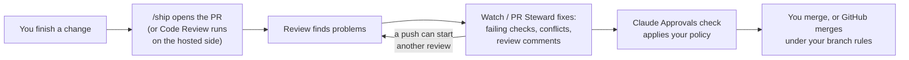

# Claude Ship: from open PR to ready to merge

You commented SHIP, so here's the full breakdown.

**The short version.** Claude Ship is Anthropic's set of agents for GitHub pull requests: [Code Review](https://code.claude.com/docs/en/code-review) finds problems, [PR Steward](https://code.claude.com/docs/en/pr-steward) pushes fixes, and [Claude Approvals](https://code.claude.com/docs/en/approvals) checks the PR against an approval policy you write. Your settings and GitHub branch rules decide what merges ([Claude Ship](https://code.claude.com/docs/en/claude-ship)). There are two ways to use it. On your own, you type `/ship` in your Claude Code CLI session. For a team, an organization turns on the hosted agents per repository. Everything below was checked against the official docs on Nov 24, 2026.

## Two ways to use it

| | Personal: `/ship` and `/steward` | Team: hosted Claude Ship |
|---|---|---|
| Where it runs | Your Claude Code CLI session, in your local clone. Cloud sessions don't have the commands ([/ship](https://code.claude.com/docs/en/ship-command)) | Anthropic infrastructure. Steward works in a cloud session ([PR Steward](https://code.claude.com/docs/en/pr-steward)) |
| Plan | Any plan. `/code-review` "works on any plan" ([local review](https://code.claude.com/docs/en/code-review-local)) | Team and Enterprise organizations ([Claude Ship](https://code.claude.com/docs/en/claude-ship)) |
| Status | Available in Claude Code 2.1.330+ ([/ship](https://code.claude.com/docs/en/ship-command)) | Code Review is generally available. PR Steward and Claude Approvals are in public beta ([Claude Ship](https://code.claude.com/docs/en/claude-ship)) |
| Who it acts as | You, through your `gh` and `git` sign-ins ([/ship](https://code.claude.com/docs/en/ship-command)) | The Claude GitHub App ([PR Steward](https://code.claude.com/docs/en/pr-steward)) |
| Who turns it on | You type the command | An Owner of the Claude organization, one repository at a time. Approvals starts when a policy file merges ([Claude Ship](https://code.claude.com/docs/en/claude-ship), [Approvals](https://code.claude.com/docs/en/approvals)) |
| Billing | Counts against your normal Claude Code usage ([/ship](https://code.claude.com/docs/en/ship-command)) | Tokens, billed to the organization's usage credits, separate from plan usage ([Claude Ship](https://code.claude.com/docs/en/claude-ship)) |
| Who merges | You do | GitHub, following your branch rules, auto-merge or merge queue ([Approvals and GitHub rules](https://code.claude.com/docs/en/approvals-github-rules)) |

## How it works



The `/ship` path is review, then watch, then you merge ([/ship](https://code.claude.com/docs/en/ship-command)). The Approvals step is only on the hosted side.

## Personal: /ship and /steward

**What you need** ([/ship](https://code.claude.com/docs/en/ship-command)):

- Claude Code v2.1.330 or later
- GitHub CLI 2.63 or later, signed in with `gh auth login`. With an older version, Claude can't push fixes
- git 2.38 or later. With an older git, Claude leaves base-branch merges to you
- Auto mode if you want it to work unattended. In most other modes Claude waits at each prompt, and in `bypassPermissions` mode no watch starts
- Not native Windows. No watch starts there

**What `/ship` does** ([/ship](https://code.claude.com/docs/en/ship-command)):

1. **Pull request.** It can commit your work, push your branch and open the PR, as you. On the default branch it commits on a new branch. There's no confirmation prompt, only an `Esc to cancel` line before the commit and before the push.
2. **Review.** Claude reviews the change with the local [`/code-review`](https://code.claude.com/docs/en/code-review-local).
3. **Watch.** Claude keeps checking the PR from your session. It works on failing checks (and re-runs failed ones), merge conflicts, reviewers' comments and its own review findings, pushes fixes, answers comments and resolves threads.
4. **Merge.** When checks pass and comments are answered, Claude says so. You merge it yourself.

`/steward` skips steps 1 and 2. Use it on your own open PR when you don't want a review, or to restart a watch that ended.

**Check it first.** `/ship` can commit every uncommitted file, new files included. Run `git status` and stash or delete what shouldn't go in. It looks for secrets by file name only, such as `.env`, so look inside your files yourself ([/ship](https://code.claude.com/docs/en/ship-command)).

**What the watch can't do.** When Claude acts without a message from you, Claude Code blocks `gh` and `git` commands that merge the PR, approve it, turn on auto-merge or force-push. It also limits Claude to a short list of `gh` and `git` commands and refuses tools like connectors, `WebFetch` and `WebSearch`. Type `/ship terms` to see the limits ([/ship](https://code.claude.com/docs/en/ship-command)).

Those limits aren't a wall. The docs list cases that can still lead to a merge ([/ship](https://code.claude.com/docs/en/ship-command)):

- Auto-merge is already on for the PR. A fix Claude pushes can let GitHub merge it. Turn it off with `gh pr merge --disable-auto <number>`
- You type a message while Claude is idle. The limits are off while Claude answers you
- Your branch rules let you merge without another person, since the watch uses your credentials

The docs also warn: run a watch only where you trust everyone who can merge to the base branch or push to your branch, because their code can run on your computer with your credentials.

**Check, stop, restart** ([/ship](https://code.claude.com/docs/en/ship-command)):

| You want to | Do this |
|---|---|
| See if a watch is running | `/tasks`. It shows as a task starting with `/steward --tend` |
| Stop it | `/ship stop` in the session running it. Press `Esc` to stop the current turn too |
| Restart it | `/steward` |
| Pick review effort | `/ship low` up to `/ship max`. Default is `high` |
| Have it read another bot | `/steward +my-lint-bot` |

A watch also ends when the PR is merged or closed, after seven days, if you check out another branch, close or background the session, or run `/clear` ([/ship](https://code.claude.com/docs/en/ship-command)). Keep the session open, in the foreground, and the computer awake. Start your next change in a second clone.

**Repo instructions.** Put a `.claude/skills/steward/SKILL.md` in the repo to tell Claude which checks matter and how to run tests. Local watches and the hosted PR Steward both read it ([/ship](https://code.claude.com/docs/en/ship-command)).

## Team: hosted Claude Ship

An Owner turns it on at **Organization settings > Claude Ship**, one agent at a time, in one repository, in this order: Code Review, then PR Steward (start with **Manual (@claude steward)**), then Approvals in observe mode ([Claude Ship](https://code.claude.com/docs/en/claude-ship)). It's not available with Zero Data Retention, the HIPAA configuration or customer-managed encryption keys.

**Code Review.** Several agents read the diff and the surrounding code in parallel, a verification step filters false positives, and findings land as inline comments ranked by severity, plus a **Claude Code Review** check. It reads code without building or running it, and the check doesn't conclude as a failure. Levels are Quick, Standard (default) and Deep. It follows `REVIEW.md` from the base or default branch, never from the PR's own changes ([Code Review](https://code.claude.com/docs/en/code-review)).

**PR Steward.** Works on failing checks when the cause is in code the PR touches, merge conflicts, small specific review requests, and Code Review findings marked **Important**. It skips forks, PRs opened by bots, and authors without write access. Stop it on a PR by removing the `claude-pr-steward-watching` label or commenting `@claude stop`. It's "designed not to approve or merge pull requests" ([PR Steward](https://code.claude.com/docs/en/pr-steward)). Before turning it on, the docs say to require at least one approval on the default branch, dismiss stale approvals on new pushes, and keep the Claude GitHub App off the ruleset's bypass list ([Steward setup](https://code.claude.com/docs/en/pr-steward-setup)).

**Claude Approvals.** A policy file at `.claude/approvals.yml` on the default branch, and a **Claude Approvals** check that reports who still has to approve, for example **Waiting on human review from any person (1/2)**. Where the policy allows, Claude can post an approving review. The check blocks a merge only where you make it a required check in GitHub, and normally not in observe mode ([Approvals](https://code.claude.com/docs/en/approvals)). A condition can't read CI results, so keep CI as its own required check ([Approvals](https://code.claude.com/docs/en/approvals)).

### A starter approvals.yml

This one is from the [setup docs](https://code.claude.com/docs/en/approvals-setup). It asks for two people, drops to one plus Claude's approval when Code Review passes, and keeps two people on anything under `.claude/`:

```yaml
# .claude/approvals.yml
version: 1
mode: observe
rules:
  - purpose: "A change takes two people. When Claude's review passes, one is enough and Claude approves."
    paths: ["**"]
    verdict: { claude: comments, seats: 2 }
    override:
      - { if: "claude/code_review = pass", verdict: { claude: approves, seats: 1 } }
  - purpose: "A change to the review rules takes two people."
    paths: ["**/.claude/**"]
    nested: inherit
    verdict: { claude: comments, seats: 2 }
```

One seat can be filled by the author ([Approvals](https://code.claude.com/docs/en/approvals)), so `seats: 1` means nobody else has to look. Start in observe mode, compare the check titles with what your reviewers decide, then delete `mode: observe` and make **Claude Approvals** a required check, with the Claude app as its source ([setup](https://code.claude.com/docs/en/approvals-setup)).

If you want a real person on every change, the docs give this rule ([Approvals and GitHub rules](https://code.claude.com/docs/en/approvals-github-rules)):

```yaml
# .claude/approvals.yml
version: 1
rules:
  - purpose: "A change takes one person who isn't an author."
    paths: ["**"]
    nested: inherit
    verdict:
      claude: comments
      seats: [{ count: 1, from: [humans, "!pr/authors"] }]
    advisory: [claude/code_review]
```

Keep `claude/code_review` somewhere in your policy. Once a policy file is on the default branch, automatic Code Reviews normally stop where no matching rule names it, even in observe mode ([Claude Ship](https://code.claude.com/docs/en/claude-ship)).

### The merge is GitHub's job

Claude Ship doesn't merge. Your branch rules, auto-merge or merge queue do ([Approvals and GitHub rules](https://code.claude.com/docs/en/approvals-github-rules)).

**The warning that matters most:** if you use GitHub auto-merge or a merge queue with a policy that doesn't require a person's approval, a change can merge without anyone acting ([Claude Ship](https://code.claude.com/docs/en/claude-ship)). Ways that happens, per the docs ([Approvals](https://code.claude.com/docs/en/approvals), [GitHub rules](https://code.claude.com/docs/en/approvals-github-rules)):

- The **Claude Approvals** check isn't required in GitHub
- `seats: 1` (the author fills it) or `seats: 0` (a bot's PR can merge with no person)
- GitHub's "require one approval" rule counts Claude's approving review
- `claude: approves` with no review condition. It starts no Code Review by itself, so Claude can approve a change nothing has reviewed
- Files no rule covers. GitHub counts the neutral result as passing
- A classifier condition, since the PR's own text can steer a classifier's answer

Also turn on **Dismiss stale pull request approvals when new commits are pushed**, because GitHub can keep counting Claude's approval after a new push ([GitHub rules](https://code.claude.com/docs/en/approvals-github-rules)).

### What it costs

There's no flat per-review price. Each agent is billed on tokens through the organization's usage credits, separately from plan usage ([Claude Ship](https://code.claude.com/docs/en/claude-ship), [review costs](https://code.claude.com/docs/en/code-review-costs)). Review cost scales with review level, change size and code complexity, and **After every push** multiplies it by the number of pushes. The limits you set are in dollars, at **Organization settings > Usage**:

| Agent | Limit |
|---|---|
| Code Review | Monthly spend limit for the whole org. Reviews are skipped when it runs out ([review costs](https://code.claude.com/docs/en/code-review-costs)) |
| PR Steward | Monthly limit, plus a per-PR spend cap in each repo. No limit at all until you set one. Spend can pass the per-PR cap before it stops ([Steward setup](https://code.claude.com/docs/en/pr-steward-setup)) |
| Claude Approvals | Classifier runs have their own limit. The reviews a policy starts count under Code Review's limit. Observe mode is billed ([Approvals setup](https://code.claude.com/docs/en/approvals-setup)) |

Turning off usage credits doesn't stop an agent that's on. To stop charges, turn off Approvals first, then PR Steward, then Code Review, because a policy can start billed reviews even where Code Review is off ([Claude Ship](https://code.claude.com/docs/en/claude-ship)).

For a pilot, the docs suggest a spend limit, a few repos on **Once after PR creation** or **Manual**, then multiplying the average cost per review by your monthly PR count ([review costs](https://code.claude.com/docs/en/code-review-costs)).

## How I use this pattern

I run a software factory where review, fixing, verifying and approving are separate agents, each with its own job and its own limits. Claude Ship is the same idea packaged for GitHub: one agent finds problems, another fixes them, and a policy decides who signs off. The part I'd copy first, whatever tools you use, is keeping the merge decision outside the agent that wrote or fixed the code.

## Fine print

- PR Steward and Claude Approvals are public beta, so details can change ([Claude Ship](https://code.claude.com/docs/en/claude-ship)).
- Claude Ship "uses AI and may miss bugs, security vulnerabilities, or other issues." A review with no findings doesn't mean the code is safe ([Code Review](https://code.claude.com/docs/en/code-review)).
- Asking Claude in chat to "check with me before pushing" is a request, and Claude Code doesn't enforce it ([/ship](https://code.claude.com/docs/en/ship-command)).
- Admins can turn off `/ship` and `/steward` with `skillOverrides` (`ship-local` and `steward` set to `off`) in managed settings ([/ship](https://code.claude.com/docs/en/ship-command)).

## Want more like this?

More agent breakdowns and the full lessons are inside my Skool community, **Agent Architects**: https://www.skool.com/agent-architects
