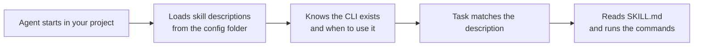

# Make any CLI tool discoverable to your agent

You commented "discover", so here's the full breakdown.

You can use a skill to make a CLI tool automatically discoverable. Write one small skill for the tool, put it in your agent's config folder, and from then on your agent knows the tool exists and how to use it, every time it starts in that folder.

The short version:

- **A tool gives your agent the capability** to do something.
- **A skill gives your agent the instructions** for how to do it.

Pairing the two is the foundation of agentic automations. Tools give your agent the ability. Skills give it the know-how to use that ability.

---

## Why this works

Skills are folders with a `SKILL.md` file. Each `SKILL.md` starts with a short name and description. When your agent starts, it loads only those descriptions into its context window. The full body of the skill is read later, when the task calls for it.

So when your agent starts in a folder that has a skill for a CLI tool in its agent config folder, it already has one line telling it:

1. This tool exists on this machine.
2. This is when to reach for it.

Then, when your task matches that description, it reads the full `SKILL.md` and learns the exact commands. You don't have to paste usage notes into every prompt, and you don't have to remember to tell the agent the tool is installed.

Without the skill, the CLI is installed but invisible. The agent might guess at commands, pick a different tool, or write a script from scratch.



## Where the skill lives

| Agent | Project skill location |
|---|---|
| Claude Code | `.claude/skills/<skill-name>/SKILL.md` |
| Codex | the skills folder in its config, for example `.agents/skills/<skill-name>/SKILL.md` |

Both follow the Agent Skills format (a folder with a `SKILL.md` that has `name` and `description` frontmatter). Check each tool's docs for the current folder names, since these move. Put the skill in the project folder to scope it to that project, or in your personal skills folder to have it everywhere.

---

## Make any CLI discoverable: step by step

We'll use `gh`, the GitHub CLI, as the example. Swap in your own tool.

**1. Install the tool and check it works yourself.**

```bash
gh --version
gh auth status
```

If you can't run it in your terminal, your agent can't either.

**2. Collect what the agent needs to know.**

Run `gh --help` and the help for the commands you actually use. Write down:

- What the tool is for, in one sentence.
- The 5 to 10 commands you use most, with real flags.
- How output should be read (JSON flags, exit codes).
- What goes wrong: auth, rate limits, commands that change things.

Or ask your agent to draft it: "Read `gh --help` and `gh pr --help`, then draft a SKILL.md for this CLI using the template in this folder."

**3. Create the skill folder.**

```bash
mkdir -p .claude/skills/github-cli
```

**4. Write the description first.** This is the most important line. It is the only part loaded at startup, so it has to say what the tool does and when to use it. Name the situations ("pull requests, issues, releases, GitHub Actions runs"), not just the tool.

**5. Write the body.** Usage, common commands, gotchas. Keep it short and concrete. Commands the agent can copy are better than prose.

**6. Test it.** Start a fresh session in the folder and ask something that should trigger it, without naming the tool:

```text
List the open pull requests in this repo that are waiting on my review.
```

If the agent reaches for `gh pr list` without being told, the skill is discoverable. If it doesn't, the description is usually the problem. Rewrite it so it matches how you actually phrase the task.

**7. Keep it current.** When the CLI adds or changes a command, update the skill. A stale skill is worse than none because the agent trusts it.

---

## SKILL.md template

Copy this to `.claude/skills/github-cli/SKILL.md` (or your agent's skills folder) and edit it.

````markdown
---
name: github-cli
description: Use the GitHub CLI (gh) for anything on GitHub: pull requests, issues, releases, repo info, and GitHub Actions runs. Use when the task mentions a PR, an issue, a review, a release, a workflow run, or a GitHub repo.
---

# GitHub CLI (gh)

`gh` is installed and authenticated on this machine. Prefer it over the web UI or raw API calls.

## Before you start

- Check auth: `gh auth status`
- Run commands from inside the repo so `gh` picks the right repo, or pass `--repo OWNER/NAME`.

## Common commands

```bash
# Pull requests
gh pr list --state open
gh pr view 123
gh pr create --title "..." --body "..."
gh pr checks 123
gh pr diff 123

# Issues
gh issue list --label bug
gh issue view 45
gh issue create --title "..." --body "..."

# Actions runs
gh run list --limit 5
gh run view <run-id> --log-failed

# Machine-readable output
gh pr list --json number,title,author --jq '.[] | "\(.number) \(.title)"'
```

## Gotchas

- Commands that create, merge, close, or comment change things on GitHub. Ask before running them unless the task clearly asked for it.
- `gh pr merge` needs a merge method flag (`--squash`, `--merge`, or `--rebase`) when run non-interactively.
- Lists are paginated. Use `--limit` when you need more than the default.
- If a command fails with an auth error, run `gh auth status` and stop. Do not try to work around it.
- Never print or log tokens.
````

---

## Tool versus skill

| | Tool | Skill |
|---|---|---|
| What it is | A program the agent can run (CLI, script, MCP server) | A `SKILL.md` file with instructions |
| What it gives the agent | The capability | The know-how |
| Loaded at startup | No, it just exists on the machine | Only the name and description |
| Without the other | Installed but unknown or misused | Instructions for something that isn't installed |

## What to do next

Pick one CLI you already use with your agent and write its skill today. Start with the description and three commands. Test it in a fresh session. Add gotchas each time the agent trips on something.

For the full lesson and more agent workflows, join the [Agent Architects community](https://www.skool.com/agent-architects).

---

## Sources

- Claude Code skills: https://code.claude.com/docs/en/skills
- Agent Skills standard: https://agentskills.io
- GitHub CLI manual: https://cli.github.com/manual/
