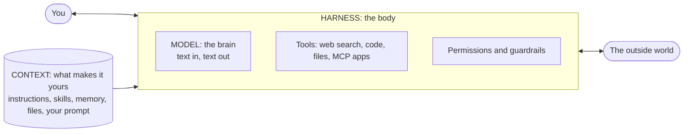

# Every AI agent is made of 3 parts

You commented "agent", so here's the full breakdown.

Every AI agent you've used, Claude Code, Codex, Cursor, ChatGPT, is made of the same three parts:

1. **The model.** The brain.
2. **The harness.** The body.
3. **The context.** What makes it *yours*.

Once you can see these three parts, agents stop feeling like magic. You'll know why your agent made something up, why it forgot what you told it yesterday, and why the same tool works great for one person and badly for another. And you'll know which part to fix.

*Facts on this page checked against official docs on November 8, 2026. Links at the bottom. This stuff moves fast, so check the links if you're reading this much later.*

---

## The picture



---

## Part 1: The model (the brain)

The model is a large language model (LLM). It's a neural network, and yes, it's loosely modeled on the human brain, even though it works very differently.

At its most basic level, a model is a huge set of numbers sitting in a data center. Your prompt gets turned into numbers, those get multiplied through the numbers in the model, and the numbers that come out the other end get turned back into text. That's the response you see.

**What it can do on its own:** take text in, give text out. This is where all the raw intelligence lives. Reasoning, writing, coding, analysis, all of it comes from here.

**What it can't do on its own:**

- Take any action. A bunch of numbers multiplying in a data center can't open a file, send an email or search Google.
- Know anything recent. It answers from what it was trained on, not from the internet. Every model has a cutoff. Anthropic's current Claude models list a reliable knowledge cutoff of June 2026, so on their own they don't know what happened last month.
- Remember you. Every conversation starts from zero unless something outside the model feeds your history back in.

**Models aren't programmed.** There's no one sitting there writing "when someone asks what color an apple is, say red." Models are trained (grown, really) on huge amounts of data. That's why they're probabilistic, not deterministic like the computer you're reading this on. Send the same prompt many times and you can get different answers back. It's also why they can hallucinate: they produce the most likely-sounding answer, and likely-sounding isn't always true.

**Real models right now (Nov 2026):**

| Company | Models |
|---|---|
| Anthropic | Claude Fable 5.1, Claude Opus 5.5, Claude Sonnet 5.5, Claude Haiku 5.5 |
| OpenAI | GPT-6 Astra, GPT-6.1 Sol, GPT-6.1 Terra, GPT-6 Luna |
| Google | Gemini 4 Argon, Gemini 3.8 Flash |

Each company ships a ladder: a biggest and smartest model, a balanced one, and a fast, cheap one. Bigger is slower and costs more per token. Smaller is fast and cheap but gets more wrong on hard work.

### Misconceptions about the model

- **"ChatGPT is a model."** It isn't. ChatGPT is an app (a harness) that runs OpenAI's models. Claude.ai and Claude Code are both harnesses running Claude models. Same brain, different bodies.
- **"It searched the web for that."** Only if the harness gave it a web search tool and it used it. Otherwise it's answering from memory of its training data.
- **"A better model fixes everything."** A smarter brain with no tools and no context is still a smart stranger who can't touch anything.

---

## Part 2: The harness (the body)

The harness is everything that wraps around the model so it can interact with you and with the outside world. If the model is the brain, the harness is the body: eyes, hands, a mouth and some rules about what it's allowed to touch.

There are a lot of competing definitions of "harness". The simplest one: **everything around the model that lets you interact with it, and lets it interact with you and the world.**

**What a harness gives the model:**

- **An interface.** The chat window, the terminal, the IDE panel. A way for you to talk back and forth.
- **Tools.** The ability to search the web, read and write files, run code, browse websites, or call other apps. MCP (Model Context Protocol) is the open standard most harnesses now use to plug in outside tools and data, like your calendar, Notion or a database. Claude, ChatGPT, VS Code and Cursor all support it.
- **The loop.** The model says "I want to run this command", the harness runs it, hands the result back, and the model decides the next step. That loop, repeated until the job's done, is what makes it an *agent* instead of a chatbot.
- **Permissions.** Rules about what the model can do without asking. In Claude Code, file edits and shell commands ask for your approval by default, and you can set allow and deny rules.
- **Built-in instructions.** System prompts, plus somewhere to load your files and memory from.

**Real harnesses:**

| Harness | What it is |
|---|---|
| Claude Code | Anthropic's agent for your terminal, IDE, desktop and web. Runs Claude models. |
| Codex | OpenAI's coding agent: CLI, IDE extension, cloud and the ChatGPT apps. Runs OpenAI models. |
| Cursor | An AI code editor with an agent built in. Lets you pick models from several companies. |
| ChatGPT Work | The agent inside ChatGPT for multi-step tasks across your files, apps and tools, ending in a finished deliverable. It replaced the older "ChatGPT agent". |
| Gemini CLI | Google's terminal agent for Gemini models. |

**What a harness can't do on its own:** make the model smarter, or know anything about you and your work. A model plus a harness can search the web, run code, send you messages and store memories. But it has no special ability to help *you* do *your* work yet.

### Misconceptions about the harness

- **"They're all the same, just pick the model."** Same model in two harnesses can feel completely different, because the tools, the loop, the permissions and the system prompt differ.
- **"More tools is better."** Every tool you connect adds to what the model has to think about, and adds to what it can break. Connect what you use.
- **"Writing 'never do X' in my instructions is a guardrail."** It's a request, not a lock. Claude Code's own docs say CLAUDE.md is treated as context, not enforced configuration. If something must never happen, use a real harness control: permission deny rules or a hook (a script the harness runs at set points, every time, no matter what the model decides).

---

## Part 3: The context (what makes it yours)

This is the most important part, and the one you control the most.

**Context is all the information that's available to the model while it's working.** Not what it learned in training (that's stored in the numbers). This is the information *you* supply, in the environment it's working in, whether that's a folder on your computer or a project in the ChatGPT app.

Context is what makes an agent productive in your life. And it's what makes your agent different from my agent. It's how you take your specialist human knowledge about what you do every day and turn it into something your agent can use to automate work for you.

**What counts as context:**

- **Your prompt.** What you type right now.
- **Instruction files.** Plain markdown the harness loads at the start of every session:
  - `CLAUDE.md` for Claude Code (it can also read `AGENTS.md`).
  - `AGENTS.md` for Codex, Cursor and a long list of other tools. It's an open format, sort of a README written for agents.
  - Cursor also has rules in `.cursor/rules`.
- **Skills.** Procedures that tell an agent how to get a specific thing done. In Claude Code a skill is a folder with a `SKILL.md` file. Only the short description sits in context until the skill is needed, then the full instructions load. Claude Code skills follow the open Agent Skills standard, which works across multiple tools.
- **Memory.** Notes that carry over between sessions. Claude Code has auto memory, where it writes down your corrections and preferences itself and loads them next time.
- **Files and folders.** Everything in the agent's workspace that it can read: your docs, your past work, your examples, your data.
- **Tool results.** Every web page it reads and every command output it gets back lands in context too.

**What context can't do:** context is limited. Every model has a context window (Claude's current models take up to 1M tokens), but bigger isn't automatically better. Anthropic's own research describes "context rot": the more you stuff in, the worse the model gets at recalling any one piece of it. Their advice is to treat context as "a precious, finite resource." So the job is putting the *right* information in, not all of it. That's context engineering, and it's a whole lesson on its own.

### Misconceptions about context

- **"My agent knows my business because I told it once."** Unless that went into a file or memory the harness loads, it's gone next session.
- **"Context is the prompt."** The prompt is one piece. Instruction files, skills, memory and workspace files usually do far more work than any single prompt.
- **"Dump everything in."** A 40-page instruction file full of stale rules makes your agent worse, not better. Short, specific and current wins.

---

## How the three fit together

- **Model only:** a brain in a jar. Smart answers, no actions, no memory of you. (Calling the raw API with no tools.)
- **Model + harness:** a capable stranger. It can search, code, edit files and message you. But it doesn't know how *you* work.
- **Model + harness + context:** your agent. Same brain and body everyone else can get, with your knowledge loaded in.

Here's what you should take from it: **same model, same harness, different context = a completely different agent.** You and I can both run Claude Opus 5.5 inside Claude Code. My agent knows my content pipeline, my tone and my rules. Yours knows your clients, your codebase or your inbox. Context is where the difference comes from, and it's the one part you can't buy off the shelf.

**When your agent messes up, ask which part failed:**

| Symptom | Usually the... | Fix |
|---|---|---|
| Wrong on a hard reasoning task, sloppy logic | Model | Try a bigger model or a higher effort setting |
| Made up recent facts | Harness (no search) or model (cutoff) | Give it web search and tell it to check |
| "I can't do that" / can't reach your app | Harness | Add the tool or MCP connector |
| Did something you didn't want | Harness | Tighten permissions, add a hook |
| Ignored how you like things done | Context | Write it into CLAUDE.md / AGENTS.md or a skill |
| Forgot what you told it last week | Context | Put it in memory or a file it loads |

---

## Make your agent better at each layer

**Model: pick the right brain for the job**

- Use the biggest model for hard, long, multi-step work, and the fast cheap model for simple high-volume stuff (sorting, extracting, summarizing).
- Don't switch models every week chasing benchmarks. Keep one you know well and switch when you hit a real wall.
- Know its cutoff. If the task needs anything recent, it needs a search tool.

**Harness: choose the body that fits where you work**

- Code and files on your computer: Claude Code, Codex or Cursor.
- Docs, slides, research across your apps without a terminal: ChatGPT Work or the Claude app.
- Connect only the tools you'll use. Start with web search, file access and the one or two apps you live in.
- Set permissions on purpose. Let it read freely, make it ask before anything that sends, deletes or spends money.

**Context: build the part that makes it yours**

- Create one instruction file (`CLAUDE.md` or `AGENTS.md`). In Claude Code, `/init` writes a starter one for you.
- Rule of thumb: when you correct your agent twice for the same thing, write the correction into that file.
- Turn any task you do every week into a skill: the steps, an example of good output, and the gotchas.
- Keep reference material in files in the workspace, and point to them instead of pasting them every time.
- Prune. Every month, delete rules that are stale or that the agent already follows.

### Checklist you can do today

- [ ] Write down which model and which harness you're using right now
- [ ] Check whether your agent has web search, and whether it uses it
- [ ] Create or clean up your `CLAUDE.md` / `AGENTS.md` (keep it short)
- [ ] Add the 3 corrections you give your agent most often
- [ ] Turn one weekly task into a skill
- [ ] Review what your agent can do without asking you

---

## Paste this into your agent

Copy everything in the block below and paste it into Claude Code, Codex, Cursor or whatever agent you use. It'll audit its own three parts and tell you what to fix.

```text
You are going to audit your own setup using the 3-part model of an AI agent:
MODEL (the brain), HARNESS (the body: interface, tools, loop, permissions),
CONTEXT (everything I supply: prompt, instruction files, skills, memory, files).

Do not change anything. Only inspect and report. If you can't verify something,
say "unknown" instead of guessing.

1. MODEL: Which model are you running on, if you can tell? What is your
   knowledge cutoff? Name one kind of task I give you where a bigger or
   smaller model would be a better fit.
2. HARNESS: Which harness are you running in? List the tools you can call
   right now (web search, file read/write, shell, browser, MCP servers or
   connectors). Which of my common tasks are you missing a tool for? What can
   you do without asking me first, and is any of that risky?
3. CONTEXT: List every instruction file, skill and memory you loaded for this
   session (for example CLAUDE.md, AGENTS.md, .cursor/rules, SKILL.md files,
   memory files), with their paths. Flag anything that is stale, contradictory,
   vague, or too long. What do I keep explaining to you that should be written
   down instead?

Finish with a table: Layer | What's working | Top fix | Effort (small/medium/large).
Then give me the 3 highest-impact fixes in order.
```

---

## Want the full lesson?

This page is the short version. The full video lesson "What is an AI agent" goes deeper into each part, and it's the first lesson of the course. From there we build on it: prompt engineering, context engineering, skills, memory, and running real agents on real work.

It's all inside my Skool community, **Agent Architects**: https://www.skool.com/agent-architects

We would love to see you there.

---

## Sources

- Claude models, knowledge cutoffs and context windows: https://platform.claude.com/docs/en/about-claude/models/overview
- OpenAI models: https://developers.openai.com/api/docs/models
- Gemini models: https://aistudio.google.com/docs/models
- Model Context Protocol (MCP): https://modelcontextprotocol.io/docs/getting-started/intro
- Claude Code memory, CLAUDE.md, AGENTS.md and auto memory: https://code.claude.com/docs/en/memory
- Claude Code skills: https://code.claude.com/docs/en/skills
- Agent Skills standard: https://agentskills.io
- Claude Code permissions: https://code.claude.com/docs/en/permissions
- Claude Code hooks: https://code.claude.com/docs/en/hooks-guide
- Codex and AGENTS.md: https://learn.chatgpt.com/docs/agent-configuration/agents-md
- AGENTS.md format and supported tools: https://agents.md
- Cursor rules and AGENTS.md: https://cursor.com/docs/context/rules
- ChatGPT Work and Codex surfaces: https://learn.chatgpt.com/docs/working-with-agents
- ChatGPT agent retirement: https://help.openai.com/en/articles/11752874-chatgpt-agent
- Context engineering and context rot (Anthropic): https://www.anthropic.com/engineering/effective-context-engineering-for-ai-agents
