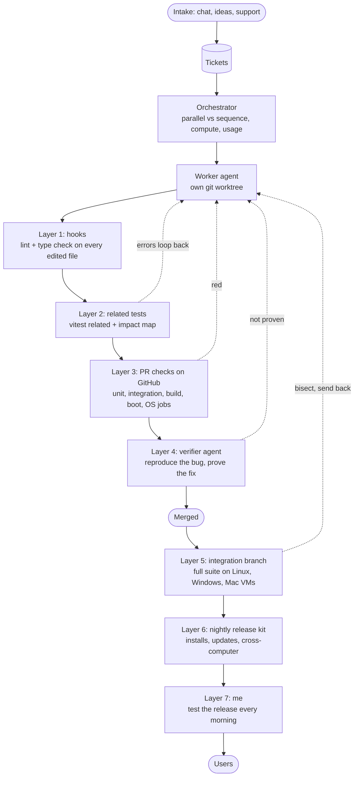

# Build your own software factory: the 7 layers of verification

You commented "factory", so here's the blueprint.

In the past 24 hours, my software factory merged 97 PRs. Agents wrote the code. What let me merge that much without breaking things is verification: seven layers of checks that every change goes through before it reaches users.

When agents write most of the code, writing code stops being the hard part. The hard part is the system around the agents: where the work comes from, who decides what gets built when, and how you know the output is actually good. That system is your software factory. This page covers all of it, but verification is the core, so most of the page is the seven layers.

My setup is highly customized to the software project my factory is building, and yours should be too. Treat this as a blueprint, not a copy-paste. It's written so you can hand it straight to your coding agent: each layer ends with something concrete it can set up for you.

*Claude Code hook details on this page checked against the official docs on November 19, 2026. Links at the bottom.*

---

## The picture



The idea behind the order: the cheap checks run on every edit, and the slow, expensive ones run less often, further from the code. Anything that fails goes back to an agent with the evidence.

---

## Before the layers: intake and orchestration

The seven layers check the work. Two things come before them: getting the work in, and handing it out.

### Intake

Bugs and feature ideas show up in Slack or Discord, your own idea list, support tickets, error logs. An intake agent pulls those on a schedule, filters out noise and duplicates, and writes each real item as a ticket. Tickets are the unit of work everything downstream reads, so vague tickets mean every agent after intake is guessing.

Put the verification criteria in the ticket, before any agent works on it:

```markdown
# [BUG|FEATURE] Short title

## Source
Where this came from (link to the thread, support ticket, idea list).

## Problem
What is wrong or missing, in 2-4 sentences. What the user sees.

## Expected outcome
What "done" looks like from the user's point of view.

## Scope
- Files / services likely touched:
- Out of scope:

## Dependencies
- Blocked by: (or "none")
- Touches the same files as: (or "none")

## Priority
P0 (broken for users now) | P1 | P2 | P3

## Verification criteria
- [ ] Bug reproduced (or feature absent) on the current code: how to see it
- [ ] Tests: which functions get new or updated tests
- [ ] User flow the verifier agent must drive (UI, API or CLI), step by step
- [ ] Operating systems this touches (Mac, Windows, Linux, or "all")
```

If a ticket can't fill in the verification criteria, it isn't ready. Send it back.

### Orchestration and delegation

An orchestrator agent (or a small hierarchy of them) takes tickets and hands them to worker agents. Its job is decisions:

- **Parallel vs sequence.** Run in parallel when tickets touch different files and no shared contract (schema, API shape, shared types, config). Run in sequence when one blocks the other, both touch the same files, or one is a migration, dependency upgrade or big refactor.
- **Prioritize vs wait.** P0 first. Then tickets that unblock the most other tickets. Wait on tickets missing verification criteria or whose blocker isn't merged.
- **Resources.** Set a max number of workers based on what your machines and AI plans can actually handle. Check remaining usage before starting a new worker. Ten half-done branches are worse than five finished ones.

Give each worker its own git worktree, so workers never edit the same checkout. A worker hands back the ticket, the branch, the evidence for each verification criterion and the PR link. A worker that says "done" without evidence isn't done.

---

## The 7 layers of verification

### Layer 1: hooks on every edit

Programmatic hooks run throughout the code base, so every time an agent edits any file, it automatically runs a lint and a type check on the edited file. The agent doesn't get to decide whether to check. The harness does it every time.

Here's a working setup for Claude Code. `.claude/settings.json`:

```json
{
  "hooks": {
    "PostToolUse": [
      {
        "matcher": "Edit|Write",
        "hooks": [
          { "type": "command", "command": "\"$CLAUDE_PROJECT_DIR\"/.claude/hooks/check-file.sh" }
        ]
      }
    ]
  }
}
```

`.claude/hooks/check-file.sh`:

```bash
#!/bin/bash
FILE_PATH=$(jq -r '.tool_input.file_path // empty')
[[ "$FILE_PATH" =~ \.(ts|tsx)$ ]] || exit 0

if ! npx eslint "$FILE_PATH" >&2; then
  echo "Lint failed on $FILE_PATH. Fix it before moving on." >&2
  exit 2
fi

# Incremental type check: after the first run, only changed files and what depends on them get rechecked.
if ! npx tsc --noEmit --incremental >&2; then
  echo "Type check failed after editing $FILE_PATH. Fix it before moving on." >&2
  exit 2
fi
exit 0
```

Make it executable with `chmod +x .claude/hooks/check-file.sh` and swap in your own linter and type checker.

How it behaves: on `PostToolUse` the edit already happened, so exit code 2 sends your error message back to the agent and it fixes the problem right away. If your harness has no hooks, a git pre-commit hook running the same checks works anywhere.

### Layer 2: related tests and an impact map

Next, the agent runs `vitest related` on the files it changed. That runs only the tests that cover those files (Vitest follows the imports), not the whole suite. On top of that we use our own custom impact map, so the agent also runs the tests for the functions it touched and everything downstream of them.

If there are any errors in any of these steps, they get looped automatically back into the agent's context window, and it fixes and reruns the tests until they all pass.

You can make that loop automatic with a `Stop` hook, so the agent can't finish while related tests are red. Add it next to the `PostToolUse` hook in `.claude/settings.json`:

```json
"Stop": [
  {
    "hooks": [
      { "type": "command", "command": "\"$CLAUDE_PROJECT_DIR\"/.claude/hooks/related-tests.sh" }
    ]
  }
]
```

`.claude/hooks/related-tests.sh`:

```bash
#!/bin/bash
CHANGED=$(git diff --name-only HEAD -- '*.ts' '*.tsx')
[ -z "$CHANGED" ] && exit 0

if ! OUT=$(npx vitest related $CHANGED --run 2>&1); then
  jq -n --arg r "Related tests failed. Fix them before you finish:
$(echo "$OUT" | tail -40)" '{decision: "block", reason: $r}'
fi
exit 0
```

`decision: "block"` keeps the agent working and hands it the reason, which here is the failing test output.

**The impact map** is a file your agents keep up to date that says which tests cover which functions and which modules depend on which. `vitest related` already follows imports. The map catches what imports miss: a config file, a shared schema, a script that calls your CLI. Start simple:

```json
{
  "src/billing/invoice.ts": ["tests/billing/*.test.ts", "tests/e2e/checkout.test.ts"],
  "config/plans.json": ["tests/billing/*.test.ts", "tests/api/plans.test.ts"]
}
```

Then have the hook run the tests from the map for every changed file, alongside `vitest related`.

### Layer 3: PR checks on GitHub

The agent submits a PR to the repo, which automatically triggers unit and integration tests, triggers builds and boots, and if any operating-system-specific files were edited, it triggers the Mac, Windows and Linux test jobs.

`.github/workflows/pr.yml`:

```yaml
name: PR checks
on:
  pull_request:

jobs:
  checks:
    runs-on: ubuntu-latest
    steps:
      - uses: actions/checkout@v4
      - uses: actions/setup-node@v4
        with:
          node-version: 22
          cache: npm
      - run: npm ci
      - run: npm run lint
      - run: npm run typecheck
      - run: npm run test:unit
      - run: npm run test:integration
      - run: npm run build
      - run: npm run boot-check   # start the built app and check it actually comes up
```

`.github/workflows/pr-os.yml` runs only when OS-specific paths change:

```yaml
name: OS-specific checks
on:
  pull_request:
    paths:
      - "src/platform/**"
      - "scripts/install/**"

jobs:
  os:
    strategy:
      fail-fast: false
      matrix:
        os: [ubuntu-latest, macos-latest, windows-latest]
    runs-on: ${{ matrix.os }}
    steps:
      - uses: actions/checkout@v4
      - uses: actions/setup-node@v4
        with:
          node-version: 22
          cache: npm
      - run: npm ci
      - run: npm run test:platform
```

Change the `paths` list to wherever your OS-specific code lives. Turn on required status checks in branch protection, so nothing merges red.

### Layer 4: a verifier agent proves the fix

This is the one I care about the most. A separate verifier agent, with its own clean context window, boots up the original code base and tries to reproduce the bug in the UI, API or CLI. It then builds and boots the code base with the fix and observes the difference between the original state and the new state.

Depending on how complex the bug fix or feature is, the verifier drives through the entire user flow of the UI or the entire agent flow of the CLI. Throughout this process it takes screenshots, screen recordings and logs, and attaches them to the PR.

Two rules make this layer work:

- **Clean context.** The verifier is not the agent that wrote the fix. It gets the ticket, the diff and the PR, not the implementer's reasoning, so it can't be talked into agreeing.
- **Before and after.** The bug has to be there on the original code and gone with the fix. If it can't reproduce the bug on the original code, it proves nothing about the fix.

A starter `SKILL.md` for the verifier:

```markdown
---
name: verify-fix
description: Use on a PR to prove a bug fix or feature works. Runs the original
  code and the fixed code side by side and drives the app like a user.
---

# Verify a fix

1. Read the ticket's verification criteria and the PR diff. Do not read the
   implementing agent's notes or reasoning.
2. Check out the base commit in its own worktree. Build and start it.
3. Reproduce the bug (or show the feature is missing) through the UI, API or
   CLI, following the ticket's steps. Screenshot or record it. Save the logs.
   If you can't reproduce it, stop and report INCONCLUSIVE with what you tried.
4. Check out the PR head in a second worktree. Build and start it.
5. Repeat exactly the same steps. Screenshot or record it. Save the logs.
6. For bigger changes, drive the whole user flow around the change, not just
   the one step.
7. Attach the screenshots, recordings and logs to the PR with a comment:
   PASS (bug present on base, gone on head) or FAIL (what still happens).
   Never report PASS on a step you didn't actually see.
8. Stop both apps and remove both worktrees.
```

Fill in the app-specific parts: how to log in with a test account, which flows matter, what "looks right" means for your product.

### Layer 5: an integration branch every few merges

About every time five new PRs land, they get merged into an integration branch, and the entire test suite runs on that branch in Linux, Windows and Mac VMs.

If any part of that goes red, an agent bisects the integration branch until it finds which merge caused it, sends it back to the implementing agent and a verification agent, and reruns all of those tests in the VMs until it goes green.

Why not run everything on every PR? The full suite on three operating systems is slow and expensive. Running it every five or so merges keeps PRs fast, and bisecting means a red run still points at one exact merge.

The bisect step, once your suite has one command:

```bash
git bisect start <integration-head> <last-green-commit>
git bisect run npm run test:full
git bisect reset
```

`git bisect run` marks each commit good or bad by the command's exit code and stops at the first bad commit. Hand that commit, the failing output and the original ticket back to the agent that wrote it.

### Layer 6: a nightly release kit

Once every 24 hours, a new GitHub release kit gets built, and then it gets tested the way users will actually get it:

- fresh installs on each operating system
- updates from every past version still in use
- cross-computer connections, including two machines on different operating systems talking to each other

This makes sure no update breaks installs, updates or core functionality. Most CI only tests the code. This tests the thing you actually ship.

How to set it up:

1. A scheduled workflow (`on: schedule`) that builds the release once per operating system.
2. A list of every version users might still be on. For each one: install it on a fresh VM, update to tonight's build, run a smoke test.
3. A test where two machines install the build and connect to each other, across each pair of operating systems you support.
4. Run the jobs in parallel, and keep the night's build as a draft until it passes.

### Layer 7: me

The last layer, which hopefully won't be necessary for much longer, is my own brain and my own eyes. The new release gets automatically installed on my home computer every morning, so when I wake up I can test it before it goes out to users.

Keep this layer short. Use the product for a few minutes the way your users do, then publish or don't. If you catch something here, it's a sign one of the six layers above is missing a check. Add it there.

---

## Grow it over time

Software factories are grown, not built in a day. Every stage runs on agents making decisions from skills: the intake skill decides what's a real ticket, the orchestrator decides parallel vs sequence, the verifier decides whether the fix is proven. You run it, watch where agents make bad calls, and fix the skills.

Then, over time, you take as much as possible out of those skills and put it in programmatic code, so it's not left to the agent's judgment. When the same kind of bad call keeps coming up and the rule is clear, turn it into a check. Leave the skills for the decisions that really need judgment.

| Decision in a skill | Same decision in code |
|---|---|
| "Always lint before finishing" | Layer 1 `PostToolUse` hook |
| "Run the tests you affected" | Layer 2 `Stop` hook with `vitest related` and the impact map |
| "Make sure tests pass before merging" | Required status checks on the PR |
| "Check it works on Windows too" | OS jobs triggered by changed paths |
| "Don't run two tickets on the same files in parallel" | Script that compares the "files touched" fields and refuses to start the second worker |
| "Don't start a worker if usage is low" | Check that reads remaining usage and queues the ticket |

---

## Set it up: the order to build in

You don't need all seven layers on day one. Build in this order:

1. **Code base first.** An `AGENTS.md` or `CLAUDE.md` with one command each for lint, type check, unit tests, integration tests, build and boot.
2. **Ticket template** with verification criteria.
3. **Layer 1:** the lint and type check hook.
4. **Layer 3:** PR checks with required status checks. Add the OS jobs when you ship on more than one OS.
5. **Layer 2:** `vitest related` (or your runner's equivalent) in a `Stop` hook, then start the impact map.
6. **Layer 4:** the verifier skill. Run it by hand on a few PRs before you make it a required step.
7. **Orchestrator** with parallel vs sequence rules and a low worker limit, then **intake**.
8. **Layers 5 and 6** once you're merging more PRs a day than you can review: the integration branch, then the nightly release kit.
9. **Every week:** read where agents made bad calls and move one rule into code.

### Checklist you can do today

- [ ] Write down the commands to lint, type check, test, build and boot in your `AGENTS.md` or `CLAUDE.md`
- [ ] Save the ticket template into your repo
- [ ] Add the Layer 1 hook
- [ ] Add a PR workflow and turn on required status checks
- [ ] Pick one recent bug and verify its fix the Layer 4 way: reproduce it on the old code, then show it's gone

---

## Paste this into your agent

Copy everything in the block below and paste it into Claude Code, Codex, Cursor or whatever agent you use. It'll audit your repo against the factory and give you a plan.

```text
I want to build a software factory for this repo: agents take work from
intake to merged code, and every change goes through seven layers of
verification. The layers:

1. Hooks: every edit runs lint and a type check on the edited file.
2. Related tests: the agent runs only the tests affected by its change
   (vitest related or equivalent, plus an impact map), and failures loop back
   into its context until they pass.
3. PR checks on GitHub: unit and integration tests, build and boot, and
   Mac/Windows/Linux jobs when OS-specific files change.
4. A verifier agent with a clean context reproduces the bug on the base
   commit, shows it gone on the PR head through the UI, API or CLI, and
   attaches screenshots, recordings and logs to the PR.
5. Every ~5 merges: the full suite on an integration branch on Linux,
   Windows and Mac. On red, bisect to the merge that broke it and send it back.
6. Nightly: build the release kit and test fresh installs, updates from every
   past version and cross-computer connections across operating systems.
7. A human tests the release before it goes to users.

Before the layers: intake turns chat, ideas and support into tickets with
verification criteria, and an orchestrator decides what runs in parallel vs
in sequence within my compute and AI usage limits.

Do not change anything yet. Inspect and report. If you can't verify
something, say "unknown" instead of guessing.

A. Code base: Is there an AGENTS.md / CLAUDE.md? Are there single commands for
   lint, type check, unit, integration, build and boot? Do they pass now?
B. For each of the 7 layers: what exists today, and what is missing?
C. Which files are OS-specific, so they should trigger the OS jobs?
D. Tickets: where do they live, and do they have verification criteria?
E. Orchestration: which parts of the repo are safe to work on in parallel,
   and which shared contracts force work into sequence?

Finish with a table: Layer | What exists | Biggest gap | Effort
(small/medium/large). Then give me a step-by-step plan in this order: code
base, ticket template, layer 1, layer 3, layer 2, layer 4, orchestrator and
intake, layers 5 and 6. Start with the smallest step I can do today.
```

---

## Want the full lessons?

This page is the short version. The full lessons go deeper on the pieces a factory is built from: context, skills, hooks, orchestrating multiple agents, and running real agents on real work.

It's all inside my Skool community, **Agent Architects**: https://www.skool.com/agent-architects

We would love to see you there.

---

## Sources

- Claude Code hooks guide: https://code.claude.com/docs/en/hooks-guide
- Claude Code hooks reference (exit code 2 per event, `decision: "block"` on Stop): https://code.claude.com/docs/en/hooks
- Claude Code skills: https://code.claude.com/docs/en/skills
- Claude Code memory and CLAUDE.md: https://code.claude.com/docs/en/memory
- AGENTS.md format: https://agents.md
- Vitest CLI (`vitest related`): https://vitest.dev/guide/cli
- TypeScript incremental builds: https://www.typescriptlang.org/tsconfig/#incremental
- GitHub Actions workflow syntax (`paths`, `matrix`, `schedule`): https://docs.github.com/en/actions/writing-workflows/workflow-syntax-for-github-actions
- GitHub branch protection and required status checks: https://docs.github.com/en/repositories/configuring-branches-and-merges-in-your-repository/managing-protected-branches/about-protected-branches
- git bisect: https://git-scm.com/docs/git-bisect
