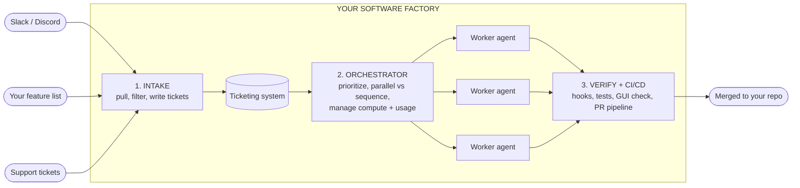

# Build your own software factory

You commented "moat", so here's the full breakdown.

When agents write most of the code, writing code stops being the hard part. The hard part is the system around the agents: where the work comes from, who decides what gets built when, and how you know the output is actually good. That system is your software factory, and the quality of it is the new moat.

There are three parts to a software factory:

1. **Intake.** Where bugs and new features show up and get turned into tickets.
2. **Orchestration and delegation.** An orchestrator agent takes tickets and hands them to worker agents.
3. **Verification and CI/CD.** Checks that run all the way through, ending in a real CI/CD pipeline on your repo.

And one idea that holds the whole thing together: a factory is grown over time, not built in a day. You run it, watch where agents make bad calls, fix the skills, and then move as much of that judgment as you can into code.

This page is written so you can hand it straight to your coding agent. Every section ends with something concrete it can set up for you.

*Claude Code hook details on this page checked against the official docs on November 9, 2026. Links at the bottom.*

---

## The picture



Verification isn't only that last box. It runs through every stage. More on that in Part 3.

---

## Part 1: Intake

Intake is where bugs and new features actually show up, and where they become inputs into your factory.

Those inputs come from places like:

- Slack or Discord channels where people talk about your product or your outputs
- Your own personal list of feature ideas
- Customer service tickets
- Plenty of other sources (app store reviews, emails, error logs, whatever you have)

The key words here are **actively pulled and filtered.** You don't wait for someone to file a perfect bug report. Your intake sources get pulled on a schedule, filtered, and turned into tickets in your ticketing system.

**Tickets are the fundamental structured unit of software that gets piped through your factory.** Everything downstream reads tickets. So if your tickets are vague, every agent after intake is guessing.

### How to set up intake

1. **Pick one ticketing system** and make it the only place work lives. GitHub Issues, Linear, Jira, or even a folder of markdown files in your repo. What matters is that agents can read and write it.
2. **List your intake sources.** Start with two or three. More sources means more noise.
3. **Give an agent an intake skill** that runs on a schedule. Its job:
   - Pull new messages and items since the last run
   - Filter out noise, duplicates and things that aren't actionable
   - Merge duplicates into an existing ticket instead of making a new one
   - Write every real item as a ticket using your template (below)
4. **Review intake output yourself at first.** You're checking whether it filters well, not just whether it runs.

### Example ticket template

This is the most important file on the page. Verification criteria go in the ticket **at the very beginning of the factory, before an agent even reads it.**

```markdown
# [BUG|FEATURE] Short title

## Source
Where this came from (link to the Slack thread, support ticket, idea list).

## Problem
What is wrong or missing, in 2-4 sentences. What the user sees.

## Expected outcome
What "done" looks like from the user's point of view.

## Scope
- Files / services likely touched:
- Out of scope:

## Dependencies
- Blocked by: #123 (or "none")
- Touches the same files as: #456 (or "none")

## Priority
P0 (broken for users now) | P1 | P2 | P3

## Verification criteria
- [ ] Unit tests: which functions get new or updated tests
- [ ] Integration tests: which service boundaries need covering
- [ ] End-to-end: which user flow must pass (step by step)
- [ ] GUI check: what the verification skill should click through and what it
      should look like
- [ ] CI passes on the PR
```

If a ticket can't fill in the verification criteria, it isn't ready to be worked on. Send it back to intake or to you.

### Misconceptions about intake

- **"Intake is just a bug form."** A form is one source. The factory pulls from wherever people already talk about your product.
- **"More tickets is more progress."** Unfiltered intake floods the factory. Filtering is half the job.

---

## Part 2: Orchestration and delegation

Step two is where you have an orchestrator agent, or possibly a hierarchy of orchestrator agents, taking tickets and delegating them to workers.

You need this layer because someone has to make decisions:

- **Parallel vs sequence.** Which tickets can be developed at the same time, and which have to wait for another one to finish.
- **Prioritize vs wait.** Which ticket goes now, and which one sits.
- **Resources.** The compute you have available to deploy agents and code on, and the usage limits of your AI plans.

That last one is easy to forget. If you spin up ten workers at once on one machine on one plan, you can run out of memory or hit your plan's limits halfway through, and now you have ten half-done branches.

A hierarchy just means the orchestrator doesn't have to be one agent. You can have a top orchestrator that owns the queue and hands groups of tickets to lower orchestrators, each running their own workers. Start with one. Add levels only when one orchestrator can't keep up.

### Orchestration rules you can copy

Put these in your orchestrator's skill and adjust to your app.

**Run in parallel when:**

- The tickets touch different files and different services
- Neither ticket is listed in the other's "Blocked by"
- Neither changes a shared contract (database schema, API shape, shared types, config)
- You have compute and plan usage left for another worker

**Run in sequence when:**

- One ticket is blocked by another
- Both touch the same files (they'll fight at merge time)
- One changes a shared contract that the other depends on
- One is a migration, a dependency upgrade or a big refactor. These go alone.

**Prioritize:**

- P0 first, always. Pause lower work if a P0 needs the capacity.
- Then tickets that unblock the most other tickets.
- Then by priority, oldest first.

**Wait on:**

- Tickets missing verification criteria (send back to intake)
- Tickets whose blocker isn't merged yet
- Anything that would push you past your compute or usage limits

**Resource rules:**

- Set a max number of workers at once, based on what your machine and plan can actually handle. Start low.
- Give each worker its own branch (a git worktree per ticket works well) so workers never edit the same checkout.
- Before starting a new worker, check how much of your plan's usage is left. If you're close, queue instead of starting.

### How workers report back

Every worker should hand back the same things so the orchestrator can decide what's next:

- The ticket ID and branch
- Which verification criteria passed, with evidence (test output, screenshots)
- Anything it couldn't verify, stated plainly
- The PR link

A worker that says "done" without evidence isn't done.

### Misconceptions about orchestration

- **"More agents in parallel is always faster."** Two agents editing the same files is slower than one, because you'll spend the time untangling it.
- **"The orchestrator should write code too."** Keep it deciding and delegating. Its context should be the queue, not the code.

---

## Part 3: Verification and CI/CD

For most software factories, this is the bottleneck. And it's because it's not just one step at the end.

**Verification needs to happen all the way through the process:** at intake, in the tickets, during orchestration and during delegation. By the time a PR shows up, most of the checking should already be done.

Here's how it stacks up.

### 1. A code base agents can easily verify

Verification really starts with a code base structured so agents can navigate it.

- Clear folder structure, one responsibility per folder
- An `AGENTS.md` or `CLAUDE.md` that says how to run the app, how to run each kind of test and where things live
- One command per check (`npm test`, `npm run lint`, `npm run e2e`, or whatever your stack uses), so an agent never has to guess how to verify
- Small files over giant ones. An agent can't verify what it can't read.

### 2. Hooks so agents can't write bad code

Configure your code base with hooks that trigger specific tests or linting rules, so your agents can't write bad code in specific files.

A hook is a script the harness runs every time at a set point, no matter what the model decides. That's the difference between a hook and a line in your instructions. Here's a working setup for Claude Code.

`.claude/settings.json`:

```json
{
  "hooks": {
    "PreToolUse": [
      {
        "matcher": "Edit|Write",
        "hooks": [
          { "type": "command", "command": "\"$CLAUDE_PROJECT_DIR\"/.claude/hooks/protect-files.sh" }
        ]
      }
    ],
    "PostToolUse": [
      {
        "matcher": "Edit|Write",
        "hooks": [
          { "type": "command", "command": "\"$CLAUDE_PROJECT_DIR\"/.claude/hooks/check-file.sh" }
        ]
      }
    ]
  }
}
```

`.claude/hooks/protect-files.sh` blocks edits to files agents should never touch:

```bash
#!/bin/bash
FILE_PATH=$(jq -r '.tool_input.file_path // empty')

PROTECTED=(".env" "migrations/" ".github/workflows/")
for p in "${PROTECTED[@]}"; do
  if [[ "$FILE_PATH" == *"$p"* ]]; then
    echo "Blocked: $FILE_PATH is protected. Ask a human." >&2
    exit 2
  fi
done
exit 0
```

`.claude/hooks/check-file.sh` lints and tests the file the agent just edited:

```bash
#!/bin/bash
FILE_PATH=$(jq -r '.tool_input.file_path // empty')
[[ "$FILE_PATH" =~ \.(ts|tsx)$ ]] || exit 0

if ! npx eslint "$FILE_PATH" >&2; then
  echo "Lint failed on $FILE_PATH. Fix it before moving on." >&2
  exit 2
fi

if ! npx vitest related "$FILE_PATH" --run >&2; then
  echo "Tests related to $FILE_PATH failed. Fix them before moving on." >&2
  exit 2
fi
exit 0
```

Make both executable with `chmod +x .claude/hooks/*.sh`. Swap `eslint` and `vitest` for your own linter and test runner.

How it behaves: on `PreToolUse`, exit code 2 blocks the edit before it happens. On `PostToolUse`, the edit already happened, so exit 2 sends your error message back to the agent so it fixes the problem right away. Other harnesses have their own hook systems. If yours doesn't, a git pre-commit hook running the same checks works in any harness.

### 3. Tests at every level

Your agents write:

- **Unit tests for every unit of code**
- **Integration tests for every relevant service**
- **End-to-end tests for the entire app**

Writing tests is cheap now. An agent can write them as fast as the code. So there's no reason to skip them, and they're what makes everything else in the factory trustworthy. Put "tests written and passing" in every ticket's verification criteria and in your worker skill.

### 4. Verification criteria in the ticket

This is the template from Part 1 doing its job. The ticket says exactly what has to pass before the agent writes a line. The worker reads it first, and the orchestrator checks the worker's evidence against it when the work comes back.

### 5. A custom verification skill that drives your app

The ticket can also trigger an agent to use a custom verification skill that you build specifically for your app. This skill lets the agent drive the GUI of your app to make sure it looks and functions well for users.

Tests tell you the code does what the code says. This tells you a user can actually use it. A starter `SKILL.md`:

```markdown
---
name: verify-app
description: Use after any change that affects what users see. Drives the running
  app like a user and checks it looks and works right.
---

# Verify the app

1. Start the app with `npm run dev` and wait until it responds on localhost.
2. Read the ticket's "GUI check" criteria.
3. Using the browser tool (for example Playwright), do each step as a user would:
   click, type, submit, navigate.
4. Take a screenshot after each step. Look at it. Check layout, text, errors,
   empty states and loading states.
5. Also check: the browser console has no errors, and the page works at mobile
   width.
6. Report each criterion as PASS or FAIL with the screenshot path. If anything
   fails, fix it and run this skill again. Never report PASS on a step you
   didn't actually see.
7. Stop the dev server when you're done.
```

Fill in the app-specific parts: how to log in with a test account, which flows matter most, what "looks right" means for your product.

### 6. PRs through a real CI/CD pipeline

Everything above is level 1 verification: checks the agent runs while it works. After all of those, your agents submit PRs that actually go through a CI/CD pipeline on your repository.

This looks different for every app and every code base, but it should be as comprehensive and as performant as possible. Comprehensive so it catches what level 1 missed. Fast so it doesn't become the new bottleneck.

A starting GitHub Actions workflow, `.github/workflows/ci.yml`:

```yaml
name: CI
on:
  pull_request:

jobs:
  checks:
    runs-on: ubuntu-latest
    steps:
      - uses: actions/checkout@v4
      - uses: actions/setup-node@v4
        with:
          node-version: 22
          cache: npm
      - run: npm ci
      - run: npm run lint
      - run: npm run typecheck
      - run: npm test
      - run: npm run build
      - run: npx playwright install --with-deps
      - run: npm run e2e
```

**CI/CD checks to have:**

- [ ] Lint and type check
- [ ] Unit and integration tests
- [ ] Build
- [ ] End-to-end tests against the built app
- [ ] Secret scanning, so no keys get committed
- [ ] Dependency checks
- [ ] Required status checks turned on in branch protection, so nothing merges red
- [ ] Deploy to a preview or staging environment before production

**Keeping it fast:** cache dependencies, run independent jobs in parallel, only run the slow end-to-end suite once the fast checks pass, and look at your slowest test file every so often.

### Misconceptions about verification

- **"CI is where verification happens."** CI is the last net. If it's the first time anything gets checked, every PR bounces and your factory stalls there.
- **"The agent said the tests pass."** Ask for the output. Better yet, have a hook or CI run them so you don't need to ask.
- **"Instructions are enough."** "Always run lint" in an instruction file is a request. A hook runs every time.

---

## Grow it over time

Software factories are like organisms. They're grown over time. They're not something you can build in one day.

Each stage of the factory involves agents making decisions based on procedures in skills: the intake skill decides what's a real ticket, the orchestrator skill decides parallel vs sequence, the worker skill decides when something is done. So you have to iterate on those skills to really get your agents making good decisions.

Then, over time, **you take as much as possible out of those skills and instill it in programmatic code.** That way you're not leaving it up to your agent's judgment.

Some examples of moving a decision from a skill into code:

| Decision in a skill | Same decision in code |
|---|---|
| "Merge duplicate tickets" | Script that matches tickets by source link before the agent sees them |
| "Don't run two tickets on the same files in parallel" | Script that compares the "Files touched" fields and refuses to start the second worker |
| "Don't start a worker if usage is low" | Check that reads remaining usage and queues the ticket |
| "Always lint before finishing" | `PostToolUse` hook |
| "Never touch migrations" | `PreToolUse` hook |
| "Make sure tests pass before merging" | Required status checks in CI |

The loop: an agent makes a bad call, you fix the skill. When the same kind of call keeps coming up and the rule is clear, turn it into code. Leave the skills for the decisions that really need judgment.

---

## Set it up: the order to build in

You don't need all of this on day one. Build in this order:

1. **Code base first.** `AGENTS.md`/`CLAUDE.md` with how to run and test everything. One command per check.
2. **Ticket template** with verification criteria. Use it by hand for a week.
3. **Hooks** for lint and related tests on edit, and protected files.
4. **CI on every PR,** with branch protection.
5. **Tests at all three levels,** filling the gaps ticket by ticket.
6. **Verification skill** that drives your app's GUI.
7. **Orchestrator** with the parallel vs sequence rules and a low worker limit.
8. **Intake skill** pulling from your first two sources.
9. **Every week:** read where agents made bad decisions, fix the skill, and move one rule into code.

### Checklist you can do today

- [ ] Pick the one place tickets live
- [ ] Save the ticket template into your repo
- [ ] Write down the commands to lint, test and build, in your `AGENTS.md` or `CLAUDE.md`
- [ ] Add one hook that lints files on edit
- [ ] Add a CI workflow that runs on pull requests
- [ ] Write down your parallel vs sequence rules

---

## Paste this into your agent

Copy everything in the block below and paste it into Claude Code, Codex, Cursor or whatever agent you use. It'll audit your repo against the three parts and give you a plan.

```text
I want to build a software factory for this repo: a system where agents take
work from intake to merged code with verification at every step. It has three
parts:

1. INTAKE: sources (chat channels, my idea list, support tickets) get pulled,
   filtered and turned into tickets. Tickets are the unit of work, and each
   ticket has verification criteria written before any agent works on it.
2. ORCHESTRATION AND DELEGATION: an orchestrator takes tickets, decides what
   runs in parallel vs in sequence and what is prioritized vs waits, manages
   compute and AI usage limits, and delegates to worker agents.
3. VERIFICATION AND CI/CD: a code base that is easy for agents to navigate,
   hooks that run lint and tests on edits, unit + integration + end-to-end
   tests, a verification skill that drives the app's GUI, and PRs that go
   through a CI/CD pipeline.

Do not change anything yet. Inspect and report. If you can't verify
something, say "unknown" instead of guessing.

A. Code base: Is there an AGENTS.md / CLAUDE.md? Are there single commands for
   lint, type check, unit, integration, e2e and build? Do they pass right now?
B. Tests: What test frameworks exist? Roughly which areas have no tests?
C. Hooks: What harness hooks or git hooks exist? Which files should be
   protected from agent edits?
D. CI/CD: What CI config exists? What runs on PRs? Is anything required
   before merge?
E. Tickets: Where do tickets live now? Do they have verification criteria?
F. Orchestration: Which parts of this repo are safe to work on in parallel,
   and which shared contracts (schema, API types, config) force work into
   sequence?

Finish with a table: Part | What exists | Biggest gap | Effort
(small/medium/large). Then give me a step-by-step plan to build the factory
in this order: code base, ticket template, hooks, CI, tests, GUI verification
skill, orchestrator rules, intake. Start with the smallest step I can do today.
```

---

## Want the full lessons?

This page is the short version. The full lessons go deeper on the pieces a factory is built from: context, skills, hooks, orchestrating multiple agents, and running real agents on real work.

It's all inside my Skool community, **Agent Architects**: https://www.skool.com/agent-architects

We would love to see you there.

---

## Sources

- Claude Code hooks guide (protected files example, exit code 2): https://code.claude.com/docs/en/hooks-guide
- Claude Code hooks reference (exit code 2 behavior per event): https://code.claude.com/docs/en/hooks
- Claude Code skills: https://code.claude.com/docs/en/skills
- Claude Code memory and CLAUDE.md: https://code.claude.com/docs/en/memory
- AGENTS.md format: https://agents.md
- GitHub Actions: https://docs.github.com/en/actions
- GitHub branch protection and required status checks: https://docs.github.com/en/repositories/configuring-branches-and-merges-in-your-repository/managing-protected-branches/about-protected-branches
- Playwright: https://playwright.dev
